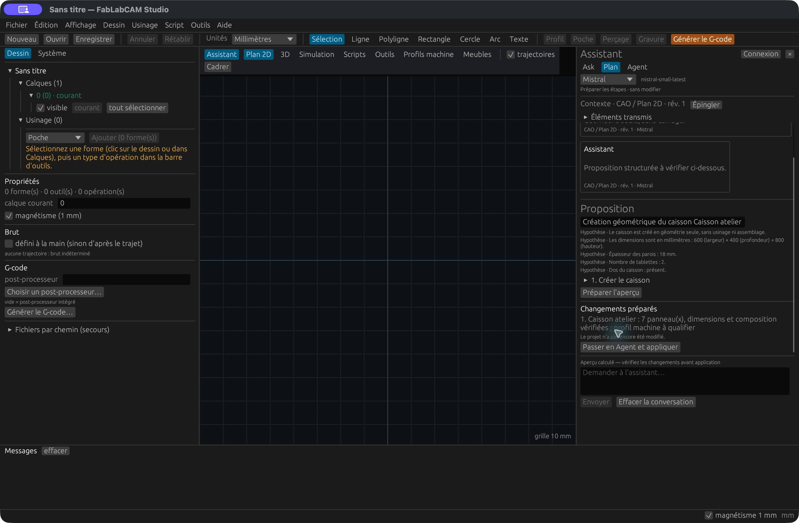
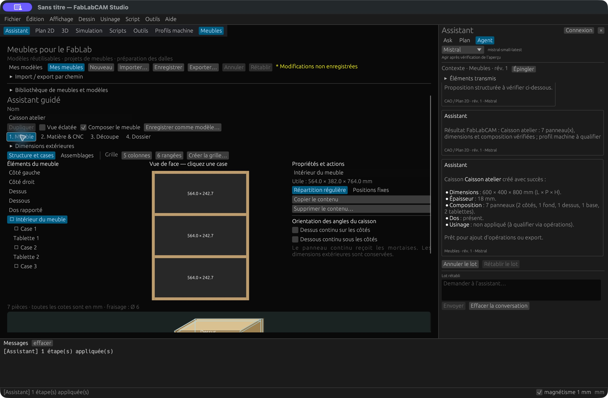
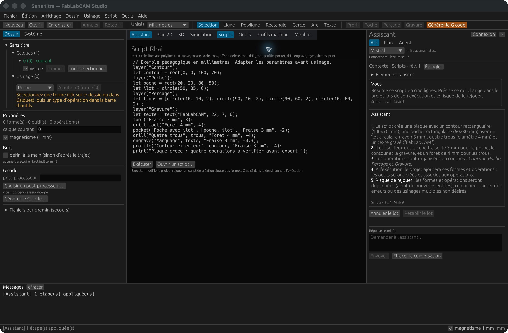
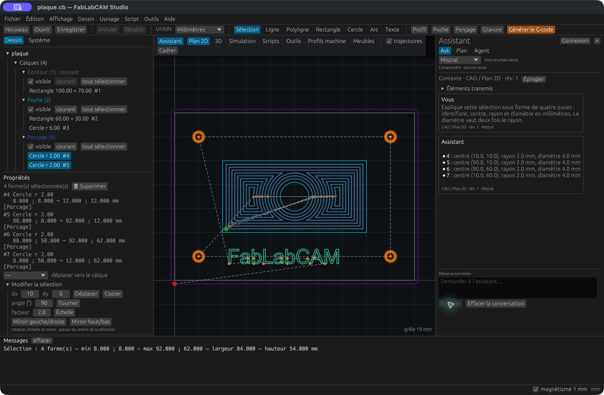
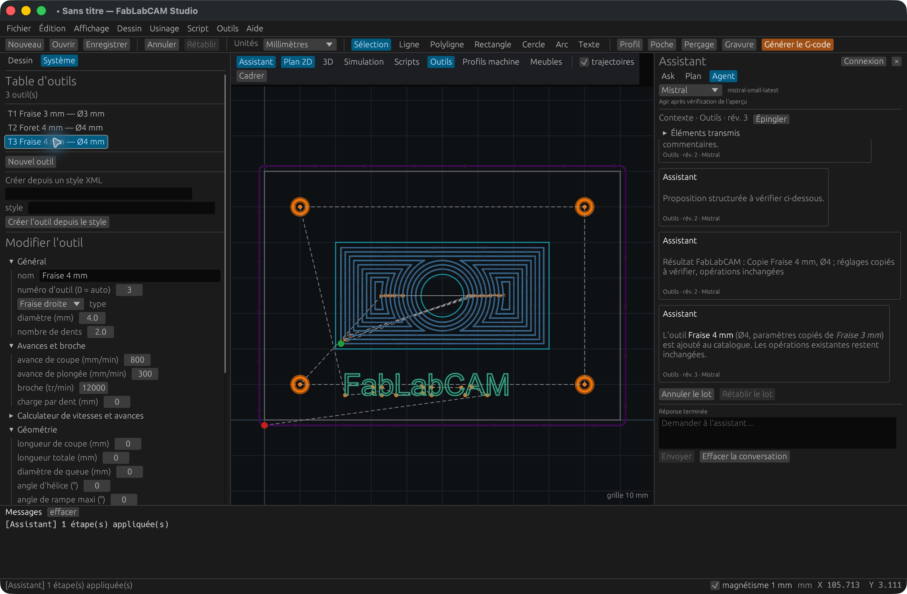
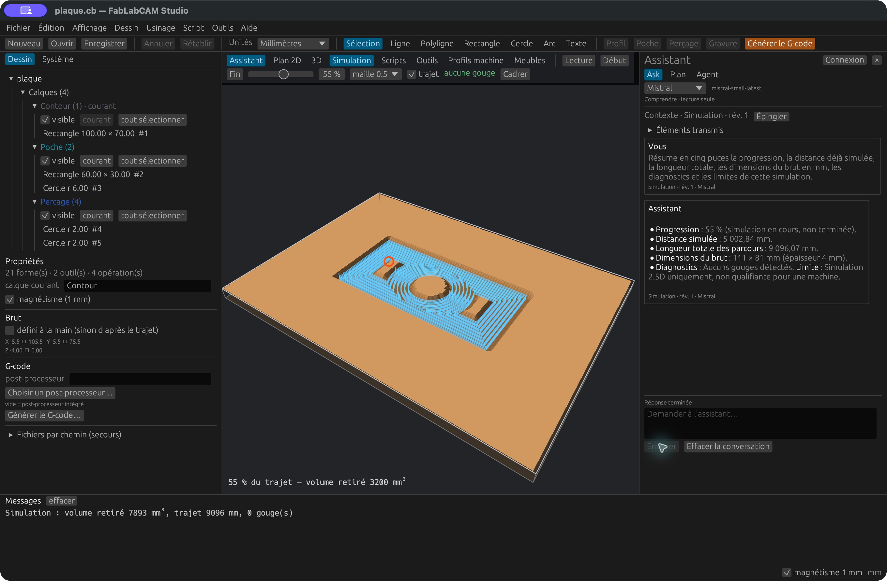

# Assistant dans le Studio

Depuis **0.7.0**, le bouton **Assistant** ouvre un panneau à droite de chaque
page : Plan 2D, 3D, Simulation, Scripts, Outils, Profils machine et Meubles.
La conversation reste visible quand vous changez de page ; son contexte suit
la page active. Redimensionnez le panneau par son bord gauche, ou repliez-le
avec **×**. Les messages et diagnostics restent dans la console du Studio.

## Connecter un modèle

1. Choisissez **OpenAI**, **Claude**, **Mistral** ou **Ollama**.
2. Ouvrez **Connexion** et saisissez l’identifiant exact du modèle disponible
   auprès de ce fournisseur. Pour l’essai Mistral de cette version :
   `mistral-small-latest`.
3. Saisissez une clé pour la session, ou utilisez une variable d’environnement.
   **Enregistrer dans le coffre système** conserve la clé séparément de la
   conversation. **Retirer du coffre** ne supprime pas une variable déjà chargée.
4. Cliquez **Tester la connexion et les outils**. Le test envoie une demande
   synthétique, sans le projet. Il peut être facturé par le fournisseur.
5. Après réception d’un appel d’outil, les propositions structurées sont
   disponibles. Un modèle limité au chat peut encore être utilisé en Ask. Une proposition
   peut nécessiter une précision : vérifiez les étapes et demandez de retirer
   celles qui dépassent votre demande avant de préparer le lot.

| Fournisseur | Clé reconnue | Service par défaut |
|---|---|---|
| OpenAI | `OPENAI_API_KEY` | API Responses OpenAI |
| Claude | `ANTHROPIC_API_KEY` | API Messages Anthropic |
| Mistral | `MISTRAL_API_KEY` | API Mistral |
| Ollama | `OLLAMA_API_KEY`, facultative | `http://127.0.0.1:11434` |

Pour Ollama, démarrer le service et installer préalablement un modèle sachant
appeler des outils. Le Studio ne télécharge pas de modèle. Un abonnement à une
application de chat ne remplace pas une clé API et les crédits de son fournisseur.
Sur Linux, le coffre nécessite Secret Service ; à défaut, utiliser la clé de
session ou l’environnement. Le fichier développeur `.env` n’est pas chargé
automatiquement par le Studio.

## Ask, Plan et Agent

| Mode | Utilisation | Effet sur le document |
|---|---|---|
| **Ask** | Comprendre une sélection, un script ou un diagnostic | Lecture seule |
| **Plan** | Préparer les étapes, relire les paramètres et calculer un aperçu | Aucun changement, aucun script exécuté |
| **Agent** | Réaliser un lot après vérification de l’aperçu | Application explicitement validée |

Exemple : « Prépare un caisson de 600 × 400 × 800 mm, épaisseur 18 mm,
avec deux tablettes et un dos. Géométrie seule, sans usinage. »

[](../assets/screenshots/49-assistant-plan.png)

Ouvrez chaque étape pour vérifier ses paramètres. Corrigez les dimensions,
le code ou les explications si nécessaire, puis cliquez **Préparer l’aperçu**.
Les éléments « à préciser » doivent être renseignés avant de confirmer leur
résolution. Le bouton **Retirer cette étape** permet de réduire le lot. Toute modification
du plan impose de recalculer l’aperçu ; les champs sont verrouillés pendant
la préparation.

**Passer en Agent et appliquer**, ou **Appliquer le lot** en mode Agent, applique
le lot affiché. Le résultat est renvoyé au modèle, qui peut expliquer le résultat
ou proposer un autre lot. Chaque lot demande une nouvelle validation.
**Annuler le lot** et **Rétablir le lot** restaurent ensemble dessin, texte Rhai
et meuble. Une autre édition entre-temps impose d’utiliser les historiques natifs.

[](../assets/screenshots/50-assistant-meubles.png)

Une proposition devient obsolète si le document, sa révision, la sélection,
la page, les filtres ou la connexion changent. Renvoyez alors la demande avec
le contexte actuel et vérifiez le nouvel aperçu.

## Choisir les éléments transmis

Dépliez **Éléments transmis** : dessin, seulement la sélection, texte du script,
meuble ouvert, outillage/opérations/profil, diagnostics/simulation et vingt derniers
échanges. Le script et le meuble sont exclus par défaut. La sélection vide
n’envoie aucune forme quand **Seulement la sélection** est coché.

**Épingler** conserve un instantané pour une question ; **Désépingler** reprend
le contexte courant. **Dernier contexte envoyé** permet de lire les données
réellement transmises. La provenance sous chaque message indique page, révision
et fournisseur. Aucun fournisseur secondaire ne reçoit de repli automatique.

L’historique est local et effaçable avec **Effacer la conversation**. Cela ne
retire pas les données déjà reçues par le fournisseur. Les clés restent séparées
de l’historique, des préférences et des projets ; ne les saisissez jamais dans
une question. Les règles de conservation du fournisseur restent applicables.

## Scripts et CAO

Dans **Scripts**, cochez **Texte du script** pour demander une explication ou
une correction. Modifier le code et l’exécuter sont deux actions distinctes.
Le mode Plan n’exécute jamais Rhai, même pour son aperçu. En Agent, l’exécution
est calculée sur une copie puis présentée avant application.

Le bouton manuel **Exécuter** utilise aussi un worker et propose un arrêt.
Rejouer un script créant des formes peut les dupliquer ; les opérations ou outils
portant déjà le même nom peuvent provoquer une erreur. Relisez le journal.

[](../assets/screenshots/51-assistant-scripts.png)

Dans **Plan 2D**, sélectionnez les formes puis demandez par exemple de modifier
le rayon des cercles en conservant leurs centres. Les identifiants affichés
permettent de vérifier la portée du lot. L’assistant peut aussi proposer un
script pour des transformations plus étendues.

[](../assets/screenshots/52-assistant-cao.png)

## Outils et simulation

Dans **Outils**, l’assistant peut créer, dupliquer ou modifier un outil du projet.
Une duplication conserve les réglages de l’original, sauf les paramètres
explicitement changés ; elle ne réaffecte pas automatiquement les opérations.
Les avances et vitesses d’exemple doivent être adaptées à votre montage.

[](../assets/screenshots/53-assistant-outils.png)

Dans **Simulation**, Ask peut expliquer la progression, les gouges et les
diagnostics transmis. Une simulation partielle est signalée comme telle ;
elle ne valide ni tout le parcours ni la machine. L’assistant ne pilote pas la CNC.

[](../assets/screenshots/54-assistant-simulation.png)

## Actions disponibles et limites

La version 0.7.0 expose : rayon et déplacement de formes, édition/exécution Rhai,
création de caisson, dimensions, division de case vide, bac, assemblage existant,
outils et opérations du projet, préparation d’exports CB/SVG/DXF/G-code et
JSON/ZIP de meuble. Les actions réutilisent les contrôles métier du Studio. Une réponse du modèle
peut être erronée ou proposer une étape superflue : comparez les unités, rayons,
diamètres et objets concernés avec les propriétés du Studio.
Le modèle ne dispose ni d’un shell ni d’un accès libre aux fichiers.

Un export constitue un lot séparé et ouvre un dialogue de destination.
« Export préparé » ne signifie pas « fichier écrit ». Les contrôles FAO et machine
restent nécessaires pour exporter le G-code. Les modifications du meuble doivent
être enregistrées explicitement dans sa bibliothèque si vous voulez les conserver.

**Arrêter** interrompt une requête ou abandonne sa préparation. Les erreurs de
clé, quota, modèle, délai ou flux incomplet sont affichées sans appliquer une
nouvelle modification. Le dialogue Connexion règle les limites de délai,
génération et tours. Les scripts ont des plafonds de taille/opérations et un
arrêt coopératif ; un calcul géométrique natif en cours peut finir avant l’arrêt.

## Validation et provenance

Captures 49 à 54 : application réelle 0.7.0, compilation de validation sur macOS
Apple Silicon, échanges réels avec Mistral `mistral-small-latest`, caisson
synthétique et [script public de la plaque](../examples/plaque.rhai).
Ce sont des captures du logiciel, pas les maquettes de conception de l’issue.

Les tests automatisés couvrent les quatre protocoles. Les essais réels de cette
version couvrent **Mistral** : caisson, séparation, scripts, outillage, retour
d’outil et simulation partielle. À la publication de 0.7.0, **OpenAI, Claude et Ollama
restaient à qualifier avec leurs services réels** ; [l’issue #20](https://github.com/FabLabCAM/core/issues/20)
reste ouverte pour ce suivi. Voir le
[rapport QA](https://github.com/FabLabCAM/core/blob/v0.7.0/docs/qa/0.7.0.md).

## Correctif de compatibilité en préparation

Le correctif suivi dans [l’issue #20](https://github.com/FabLabCAM/core/issues/20)
concerne GPT-4.1/GPT-4o et Ollama. **Il n’est pas inclus dans les installateurs
0.7.0/0.7.1** : il faut compiler la branche de correction pour ces essais.

GPT-4.1 mini ne prend pas en charge le paramètre de résumé de raisonnement envoyé
par 0.7.0. Le correctif le supprime pour cette famille tout en conservant les
métadonnées de continuation de GPT-5. Ollama reçoit une demande sans phase de
raisonnement (`think:false`), une température de 0 en Plan/Agent et des consignes
explicites sur l’enveloppe `submit_plan`. Une réponse finale vide est signalée.

Le contexte Ollama par défaut de 4 096 tokens tronque les requêtes contenant le
meuble et le catalogue. Dans ces conditions, Qwen3 1.7B, Qwen3 4B et Qwen2.5 3B
échouent après la création du caisson et son retour d’outil. Configurer un modèle
dédié avec un contexte plus grand, sans modifier le réglage global du serveur :

```sh
ollama pull qwen2.5:3b
```

Créer un fichier `Modelfile` contenant :

```text
FROM qwen2.5:3b
PARAMETER num_ctx 16384
```

Puis créer le modèle local :

```sh
ollama create fablabcam-qwen2.5:3b -f Modelfile
```

Dans **Connexion**, choisir Ollama, `http://127.0.0.1:11434` et le modèle
`fablabcam-qwen2.5:3b`, puis tester la connexion et les outils. Le modèle conserve
les mêmes poids ; seul son réglage de contexte est différent. La bibliothèque
actuelle ne transmet pas ce paramètre par les options du Studio. Un contexte
plus grand consomme plus de mémoire ; les conversations longues peuvent dépasser
16 384 tokens. Réduire les éléments transmis et l’historique si nécessaire.

**Limite constatée après ce réglage :** Qwen2.5 3B et Qwen3 1.7B passent le
caisson et le retour d’outil, mais pas la division suivante. Le contexte agrandi
est nécessaire pour ces essais, mais ne suffit pas à qualifier ces modèles pour
le parcours Agent complet. L’exemple ci-dessus décrit la configuration testée,
pas un modèle validé pour toutes les actions.

Aucune action n’est reconstruite depuis le texte libre. Les essais sont synthétiques ;
ils ne constituent pas une qualification de CNC ni une vérification graphique sur
les trois systèmes, ni un essai avec Internet physiquement déconnecté.

Essais réels du correctif réussis : **GPT-4.1 mini**, **GPT-5 mini** et
**Claude Haiku 4.5**, avec création/division de meuble, Plan, exécution Rhai,
outillage, simulation partielle et retour d’outil natif. Mistral avait été qualifié
lors de 0.7.0 ; il n’a pas été retesté dans cette campagne.
