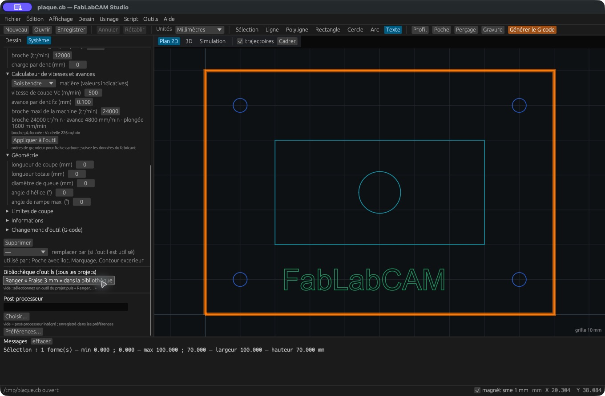

# Calculateur de vitesses et avances

[](../assets/screenshots/08-calculateur.png)

Ouvrez une fiche outil puis **Calculateur de vitesses et avances**. Choisissez
une matière ou saisissez vos propres données : vitesse de coupe `Vc` en m/min,
avance par dent `fz` en mm et limite de broche en tr/min. Le diamètre et le nombre
de dents proviennent de l’outil courant.

Les préréglages couvrent bois tendre, bois dur/MDF, plastique, aluminium et laiton.
Ils donnent des ordres de grandeur pour une fraise carbure. Utilisez les données
du fabricant et les capacités de votre montage pour les valeurs de travail.

## Calcul effectué

```text
N théorique = Vc × 1000 / (π × diamètre)
N retenu    = minimum(N théorique, limite de broche)
Avance      = N retenu × nombre de dents × fz
Plongée     = avance / 3
```

Les résultats sont arrondis. Si la broche est plafonnée, la vitesse de coupe
réelle est indiquée. Le bouton **Appliquer à l’outil** copie broche, avance,
plongée et charge par dent dans la fiche.

Exemple vérifié par les tests : diamètre 6 mm, deux dents, Vc 300 m/min,
fz 0,05 mm, plafond 30 000 tr/min → environ **15 915 tr/min**, **1 592 mm/min**
en coupe et **531 mm/min** en plongée.

La valeur de plongée est une estimation simple ; le calculateur n’analyse ni
l’engagement radial, ni la puissance, ni le bridage, ni le refroidissement.
Une opération possédant ses propres avances peut remplacer celles de l’outil.
