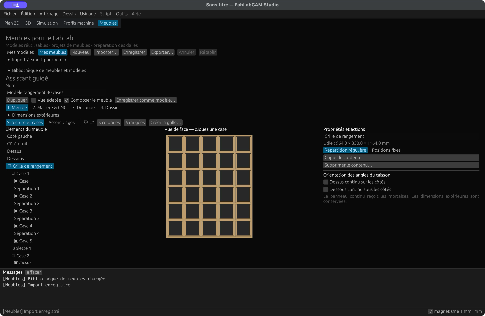
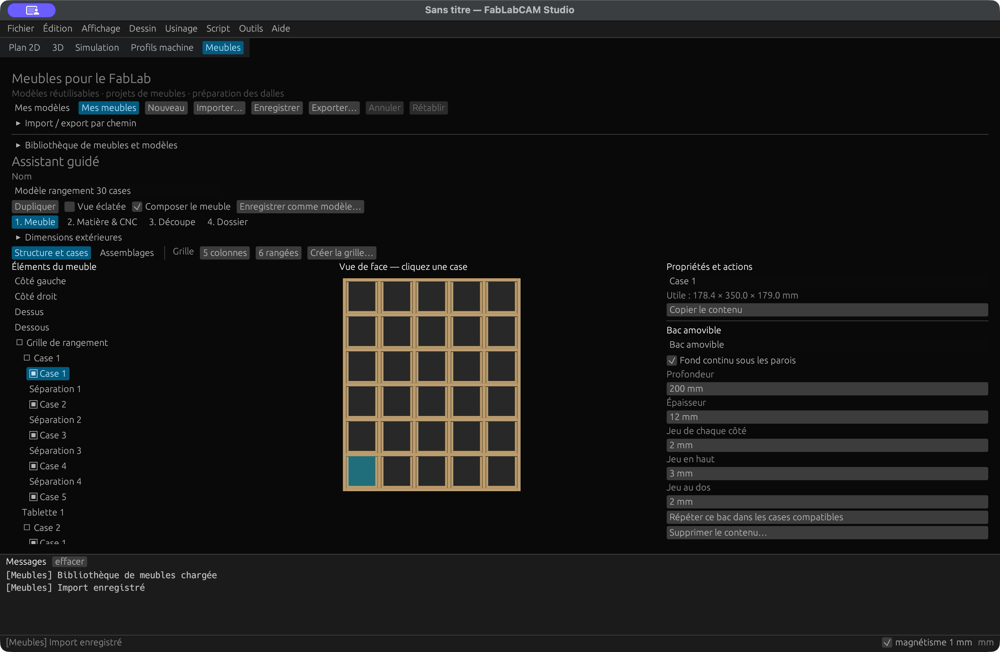
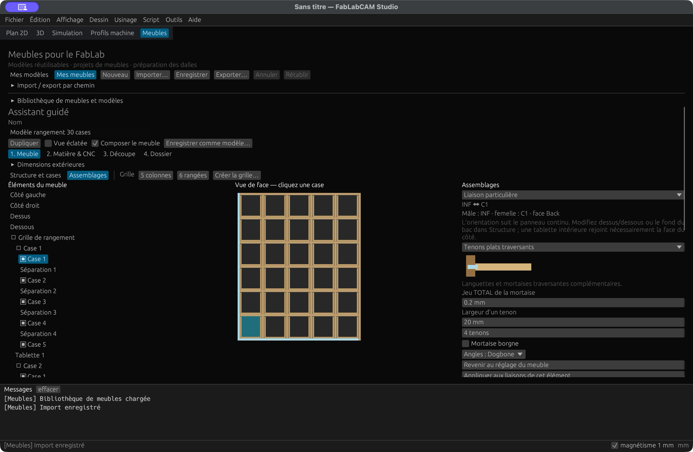
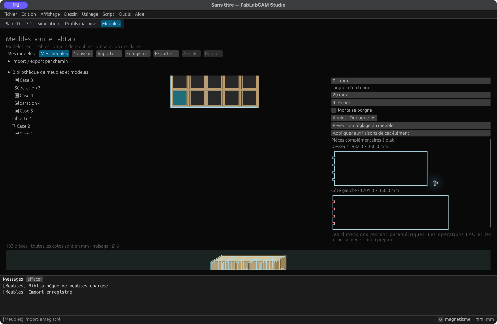
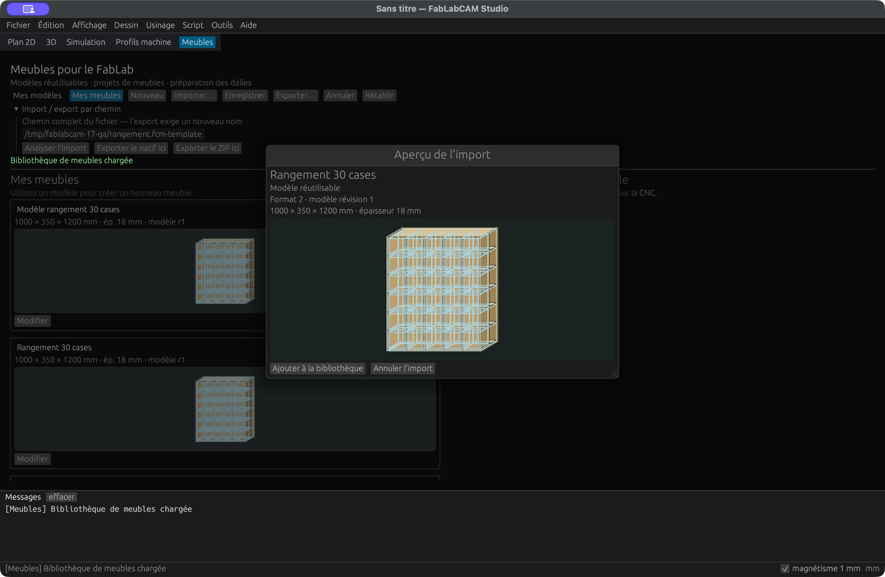
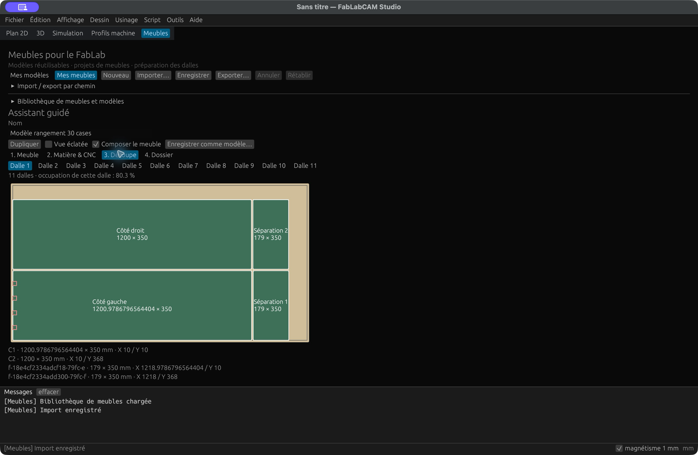

# Composer un meuble et ses assemblages

**FabLabCAM 0.6.0** ajoute un éditeur de panneaux, cases et bacs à l'espace
**Meubles**. Il complète le [parcours modèles, matière, dalles et dossier](meubles.md).
Les cotes sont en millimètres. Aucune programmation n'est nécessaire dans le Studio.

## Ajouter et modifier des éléments

Ouvrez un meuble ou utilisez un modèle, puis cochez **Composer le meuble** dans
l'étape **1. Meuble**. Un ancien caisson demande une activation explicite : sa
structure est conservée, avec des assemblages bord à bord.

[](../assets/screenshots/42-composition-structure.png)

L'arbre est à gauche, la vue de face sélectionnable au centre, les propriétés à
droite. Cliquez une case dans la vue ou son nom dans l'arbre. Les actions
s'appliquent à cette sélection :

1. **Ajouter une tablette** ou **Ajouter une séparation** divise la case sélectionnée.
2. Choisissez une division horizontale/verticale et son nombre de parties pour
   créer plusieurs cases égales. Les panneaux partagés sont générés une seule fois.
3. Sélectionnez une séparation pour changer son nom, sa position, son épaisseur
   ou sa profondeur. Sa portée reste bornée par sa case parente.
4. **Dupliquer**, **Supprimer** et **Répartir régulièrement** modifient la structure.
   Une suppression avec des enfants affiche ses conséquences avant confirmation.
5. **Annuler / Rétablir** restaure les modifications. Enregistrez pour conserver
   le document ; quitter ou changer de document protège le travail non enregistré.

Les dimensions extérieures sont repliables. **Position fixe** mesure le bord
inférieur/gauche du panneau depuis l'intérieur de sa case ; un redimensionnement
conserve cette position et signale un conflit. **Répartition régulière** recalcule
les ouvertures égales en tenant compte des épaisseurs réelles.

Sélectionnez C1, C2, SUP, INF ou DOS pour régler leur épaisseur. Les dimensions
extérieures restent celles du meuble ; les dimensions utiles changent. Le dessus
ou dessous continu peut recouvrir les côtés : ce choix inverse les pièces
mâle/femelle de ces angles. Retirer le dos nettoie les seules liaisons disparues.

## Créer 30 cases et ajouter les bacs

Le cas synthétique du guide utilise **1 000 × 350 × 1 200 mm**, une structure de
**18 mm**, **5 colonnes × 6 rangées**. Renseignez ces nombres puis **Créer la grille**.
La confirmation remplace la composition courante. Chaque ouverture mesure
**178,4 × 179 mm** avec les panneaux de même épaisseur et l'assemblage bord à bord.

[](../assets/screenshots/43-composition-bacs.png)

Dans une case, ajoutez un **bac amovible** : fond, côtés, façade et arrière,
sans coulisses ni couvercle. Réglez sa profondeur, son épaisseur et ses jeux.
Dans l'exemple : profondeur **200 mm**, épaisseur **12 mm**, jeu latéral **2 mm
par côté**, jeu supérieur **3 mm**, jeu arrière **2 mm** et fond continu sous les
parois. L'enveloppe du bac est **174,4 × 200 × 176 mm**.

Copiez le contenu de la case ou répétez les bacs dans les cases compatibles.
Chaque copie reçoit des identifiants indépendants et conserve ses assemblages.
Les cases occupées ou incompatibles sont conservées. Un bac trop grand ou un jeu
incohérent produit une erreur et bloque le dossier. Les panneaux des bacs ne
s'assemblent jamais automatiquement au caisson : les bacs restent amovibles.

!!! info "Dos et capacité de la CNC"
    Un dos monobloc de **1 000 × 1 200 mm** ne rentre pas sur une dalle
    **1 500 × 800 mm**. L'exemple exportable retire le dos : **183 pièces sur
    11 dalles**, séparées entre les épaisseurs de 18 et 12 mm. L'original avec dos
    contient 184 pièces et est refusé sur cette dalle. Il n'existe pas de découpe
    automatique d'un grand dos en plusieurs panneaux. Le contreventement et
    l'ancrage du meuble sans dos restent à concevoir.

## Choisir les assemblages

Dans **Assemblages**, choisissez **Réglage du meuble** pour le défaut général,
ou une liaison existante puis **Personnaliser cette liaison**. Les deux pièces
sont mises en surbrillance dans la vue de face. Le panneau indique les identifiants,
la pièce mâle, la pièce femelle et sa face de référence.

[](../assets/screenshots/44-composition-assemblages.png)

Le réglage général ne remplace pas les surcharges. **Revenir au réglage du meuble**
retire une surcharge. **Appliquer aux liaisons de cet élément** reprend le choix
sur les contacts de la pièce mâle. Une copie de case ou de bac remappe ses liaisons
vers les nouvelles pièces. Tous ces changements sont annulables.

[](../assets/screenshots/45-composition-pieces.png)

Les aperçus à plat montrent les contours réellement exportés : contour en bleu,
usinage traversant en rouge, poche en jaune. L'aperçu assemblé/éclaté sert à lire
l'organisation des panneaux ; il ne simule pas les efforts ni la tenue mécanique.
Les grandes grilles utilisent l'arbre et la liste des pièces pour les repères,
afin d'éviter les étiquettes superposées dans l'aperçu.

### Familles disponibles et variantes

La version 0.6.0 traite des **contacts orthogonaux de panneaux**, avec usinages
sur leurs grandes faces. Elle ne représente pas toutes les variantes traditionnelles
portant ces noms.

| Type | Géométrie produite et conditions |
|---|---|
| Bord à bord | Chants droits ; collage/vissage, avant-trous et quincaillerie à définir |
| Tenons plats | Tenons répartis sur le chant et mortaises complémentaires ; variante traversante ou borgne |
| Queues droites | Dents rectangulaires et encoches ouvertes ; liaison au bord du panneau uniquement |
| Rainure pour tablette | Engagement continu du panneau dans une rainure borgne ; tablette intérieure possible |
| Feuillure | Rainure continue ouverte au bord ; liaison de bord uniquement |
| Mi-bois | Variante d'angle : languette à mi-épaisseur sur le mâle et logement femelle ; poche au verso du mâle |
| Tenon-mortaise | Tenons rectangulaires répartis ; mortaises traversantes ou borgnes selon le réglage |
| Rainure-languette | Languette centrée au tiers de l'épaisseur ; réduction sur les deux faces et rainure complémentaire |

Mi-bois et rainure-languette demandent un retournement repéré. Une poche femelle
peut aussi se trouver au verso selon l'orientation de la pièce. Les assemblages
borgnes doivent laisser de la matière ; les types de bord refusent une tablette
intérieure. L'espacement des tenons est calculé régulièrement à partir de leur
nombre, de leur largeur et de la portée disponible.

Les huit familles complémentaires restent visibles mais **désactivées** : queue
d'aronde, demi-queue d'aronde, enfourchement, tourillons, onglet, lamelles, vissage
oblique, enture en sifflet. Aucun contour de remplacement n'est produit pour elles.
Les perçages sur chant, outils spéciaux et usinages inclinés ne sont pas générés.

### Jeux, fraise et diagnostics

Le **jeu TOTAL** agrandit une mortaise une seule fois : tenon de **20,00 mm** et
jeu de **0,20 mm** donnent **20,20 mm**, soit 0,10 mm de chaque côté centré.
Ce jeu est indépendant du jeu latéral des bacs, exprimé **par côté**.

Le diamètre de fraise vient de **Matière & CNC** ; les modèles utilisent 6 mm
pour leur aperçu. **Dogbone** ou **T-bone** dégagent les angles internes, y compris
les racines concaves des tenons. **Sans dégagement** demande une finition manuelle.
Les dégagements peuvent agrandir légèrement l'enveloppe de débit au-delà du panneau
nominal ; le placement réserve cette enveloppe complète.

Une rainure de 4 mm ne passe pas avec une fraise de 6 mm. Le moteur refuse aussi
un engagement hors matière, une poche borgne traversant toute l'épaisseur, un
nombre excessif de tenons, des usinages en collision et les références orphelines.
Deux cloisons opposées rejoignant une tablette partagée peuvent produire des
mortaises superposées : adaptez ces liaisons individuellement. Un défaut global
« tenons partout » ne rend pas toute grille automatiquement fabricable.

## Enregistrer, importer et partager les modèles

**Enregistrer comme modèle** conserve toute la composition, les bacs, les
épaisseurs, le défaut d'assemblage et les surcharges. Enregistrez le modèle dans
**Mes modèles**, puis **Utiliser ce modèle** crée un meuble autonome. Modifier
ensuite le modèle ne change pas les meubles déjà créés.

[](../assets/screenshots/46-composition-import.png)

Les formats natifs restent `.fcm-template.json` et `.fcm.json`, maintenant en
**schéma 2**. Les fichiers de schéma 1 sont lus sans réécriture ; l'enregistrement
ou l'export explicite produit le schéma 2. Un ancien catalogue local reçoit une
copie `library-schema-1.backup.json` lors de la première sauvegarde.

**Importer** affiche un aperçu et valide le document. Un identifiant existant
propose une copie indépendante. Une version inconnue ou des références invalides
sont refusées sans nettoyer silencieusement le fichier. Les exports exigent un
nouveau chemin. CB/DXF/SVG ne recréent pas la structure paramétrique : partagez
le fichier natif pour poursuivre l'édition.

## Dalles, opérations et faces d'usinage

Le placement utilise une enveloppe conservatrice des contours, tenons et
poches débordant du brut, et sépare les épaisseurs. Une pièce non plaçable bloque
le dossier complet. Le taux d'occupation tient compte des contours et trous
traversants fermés ; le placement ne garantit pas le minimum de dalles.

[](../assets/screenshots/47-composition-decoupe.png)

Le ZIP ajoute `assemblages.json` et `operations.json` aux plans, CSV, PDF, profil
et placement. Ils conservent composition, appariements, types, jeux, faces et
profondeurs. Les fichiers `dalle-NN-verso.cb/.dxf/.svg` apparaissent lorsqu'un
usinage au verso est nécessaire.

Les coordonnées locales du panneau utilisent ses deux grands axes. Un placement
tourné de 90° transforme `(u, v)` en `(H - v, u)`, puis applique la translation.
Le montage verso réfléchit **X par rapport à la largeur de dalle** :
`Xverso = largeur - Xrecto`, avec Y conservé. Les arcs sont réfléchis également.
Préparez le verso **avant** de détacher les contours recto, avec origines,
repérage et bridage définis pour chaque montage ; le logiciel ne les choisit pas.

**Préparer cette dalle en FAO** transfère le montage sélectionné, le brut, la
fraise et les exigences d'usinage. Le CB conserve ces exigences à la réouverture.
Créez les opérations avec les profondeurs et côtés attendus : une poche requise
ne peut pas être traitée comme un îlot. Le contrôle refuse les opérations
manquantes ou incompatibles. La validation du profil machine et du G-code reste
distincte ; un profil incomplet bloque l'export. Aucun G-code n'est fourni dans le ZIP.

## Exemples reproductibles

Téléchargez le [meuble](../examples/composition/rangement.fcm.json), le
[modèle](../examples/composition/rangement.fcm-template.json), le
[dossier ZIP](../examples/composition/fabrication.zip), la
[notice PDF](../examples/composition/notice-montage.pdf), la
[liste de débit](../examples/composition/liste-de-debit.csv) et le
[plan de la première dalle](../examples/composition/dalle-01.svg).
Le meuble sans dos contient 30 bacs et quatre tenons sur la liaison INF/C1.
Les autres liaisons restent bord à bord, avec fixations à définir.

Dans un dossier vide, avec la CLI 0.6.0 et les fichiers téléchargés :

```sh
fablabcam furniture validate rangement.fcm-template.json
fablabcam furniture new rangement.fcm-template.json -o mon-rangement.fcm.json
fablabcam furniture plan mon-rangement.fcm.json
fablabcam furniture pack mon-rangement.fcm.json -o mon-dossier.zip
```

Pour créer une grille par la CLI :

```sh
fablabcam furniture template cabinet -o base.fcm-template.json
fablabcam furniture new base.fcm-template.json -o grille.fcm.json \
  --width 1000 --depth 350 --height 1200 --thickness 18 \
  --columns 5 --rows 6 --bins yes
```

Cette dernière commande conserve le dos du gabarit : retirez-le explicitement dans
l'UI ou choisissez une dalle et une machine adaptées avant le dossier de fabrication.
La CLI ne modifie pas la bibliothèque du Studio.

Le [script de démonstration des huit familles](../examples/composition/assemblages-demo.py)
crée huit meubles, valide chacun et exporte ses plans et manifestes. Il requiert
Python 3 et un dossier de sortie inexistant :

```sh
python3 assemblages-demo.py /chemin/vers/fablabcam demonstrations
```

Les [résultats exécutés avec la version 0.6.0](../examples/composition/assemblages-results.json)
indiquent les montages verso produits. Ils démontrent la génération géométrique,
pas la résistance des assemblages ou la qualification d'une machine.

## Validation et limites

Les tests couvrent la composition, les huit familles annoncées, les jeux, les
collisions, le passage de fraise, les copies, les migrations, l'historique, le
placement, les exports et les exigences FAO. Voir le
[compte rendu des sources](https://github.com/FabLabCAM/core/blob/v0.6.0/docs/qa/0.6.0.md).

Les captures 42 à 47 proviennent du Studio **0.6.0 macOS Apple Silicon**, installé
depuis le paquet de cette release, avec des exemples synthétiques et une
bibliothèque isolée. Les captures historiques 35 à 41 restent celles de la 0.5.0.
Le contrôle graphique ne couvre pas Windows/Linux. Les douze paquets sont
construits et testés sur six cibles natives ; aucune machine physique n'est pilotée.

Contrôles de distribution du **4 novembre 2026** : les empreintes des douze
paquets, les architectures des dix-huit exécutables, les licences et les sources
tierces jointes ont été vérifiées. Les installations Windows/Linux sont contrôlées
en CI ; le DMG Apple Silicon a été vérifié, copié et exécuté localement.

Avec ce paquet installé : import d’un modèle, réouverture des 30 bacs et de la
liaison INF/C1, vues des contours, placement sur 11 dalles et export ZIP de
41 fichiers vérifiés dans le Studio. La CLI installée reproduit à l’identique
le contenu des 41 fichiers de l’exemple publié ; les huit démonstrations
d’assemblage et la plaque Rhai ont été exécutées. Le modèle historique de
schéma 1 reste inchangé et donne un nouveau projet de schéma 2.

[Tests et Clippy en CI](https://github.com/FabLabCAM/core/actions/runs/41812702059) ·
[Construction et contrôles des six cibles](https://github.com/FabLabCAM/core/actions/runs/41812702082).

Le premier éditeur reste orthogonal, limité à 1 024 éléments et 24 niveaux.
La façade des bacs est rectangulaire. Encoches de préhension, coulisses, portes,
charnières, formes libres, quincaillerie et calcul des charges restent à développer.
Les noms Unicode sont conservés dans le natif et les manifestes ; le PDF utilise
des libellés fixes et des identifiants. La notice est une aide au repérage,
pas un calcul de stabilité ni une instruction complète de bridage.

[Issue #17](https://github.com/FabLabCAM/core/issues/17) ·
[Release 0.6.0](https://github.com/FabLabCAM/core/releases/tag/v0.6.0).
