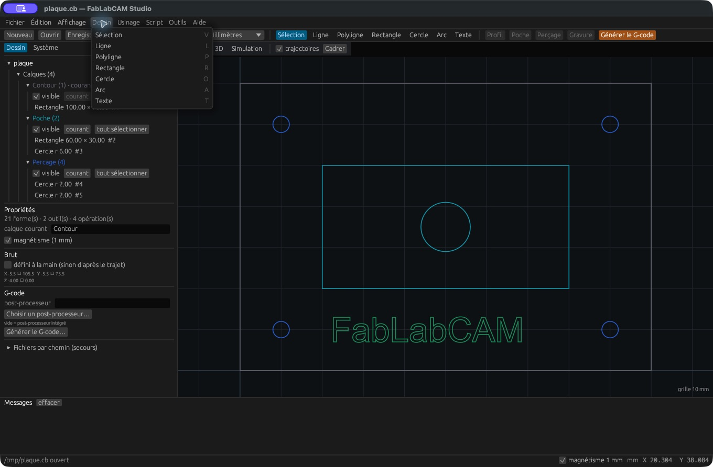

# Dessiner et sélectionner

Les outils sont accessibles dans la barre supérieure et dans **Dessin**.
Choisissez d’abord le calque courant et le pas de magnétisme. Les coordonnées
sont celles du plan XY ; les opérations définissent ensuite les profondeurs Z.

| Outil | Touche | Utilisation |
|---|---|---|
| Sélection | `V` | Cliquer une forme, `Maj` + clic pour ajouter/retirer ; glisser pour déplacer |
| Ligne | `L` | Cliquer le départ puis l’arrivée |
| Polyligne | `P` | Cliquer les sommets successifs ; clic droit pour terminer ouverte |
| Rectangle | `R` | Cliquer deux coins opposés |
| Cercle | `O` | Cliquer le centre puis un point fixant le rayon |
| Arc | `A` | Cliquer centre, début puis fin, dans le sens anti-horaire |
| Texte | `T` | Régler texte/police/hauteur puis cliquer son point d’insertion |

`Échap` abandonne le tracé en cours et vide la sélection. Pour une polyligne
fermée, appuyez sur `C` pendant le tracé, ou terminez-la puis cliquez
**Fermer** dans ses propriétés. Le menu et l’aide de la barre affichent l’action
attendue pendant le dessin.

## Sélectionner et organiser

Cliquez au plus près d’un contour visible. Pour une sélection groupée, utilisez
`Maj` + clic, **Tout sélectionner**, ou le bouton du calque. Les éléments sont
également accessibles dans l’arbre. Le clic droit en mode Sélection ouvre les
commandes de transformation, modification, usinage, presse-papiers et historique.

**Copier**, **Couper** et **Coller** manipulent le presse-papiers interne de formes.
Ce mécanisme ne constitue pas un échange universel avec une autre application de
dessin. Utilisez DXF ou SVG pour cet échange. **Supprimer** retire les formes ;
contrôlez ensuite les opérations qui les utilisaient.

## Dessiner précisément

Tracez d’abord une approximation, puis saisissez les dimensions dans les
[propriétés de l’objet](objets.md). Un rectangle 100 × 70 peut être défini avec
une origine (0, 0), une largeur 100 et une hauteur 70. Cliquez **Appliquer**.
Les poignées permettent un ajustement direct ; les champs numériques assurent
la répétabilité. Les transformations sont décrites [ici](transformations.md).
