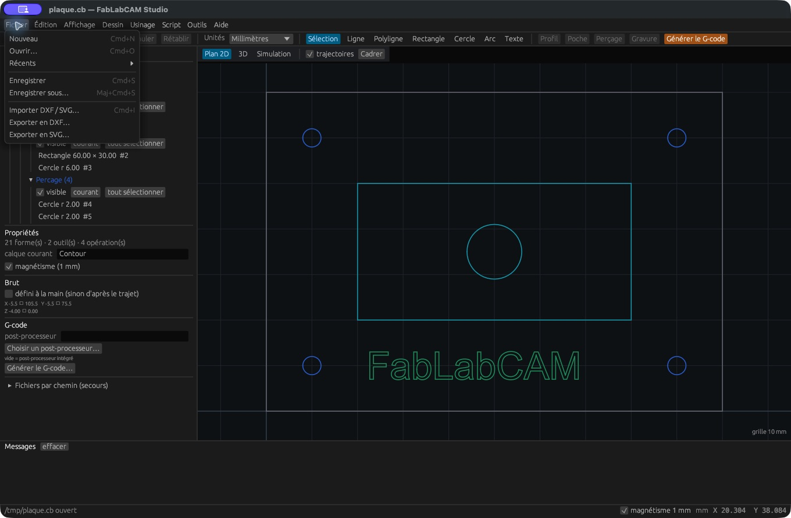
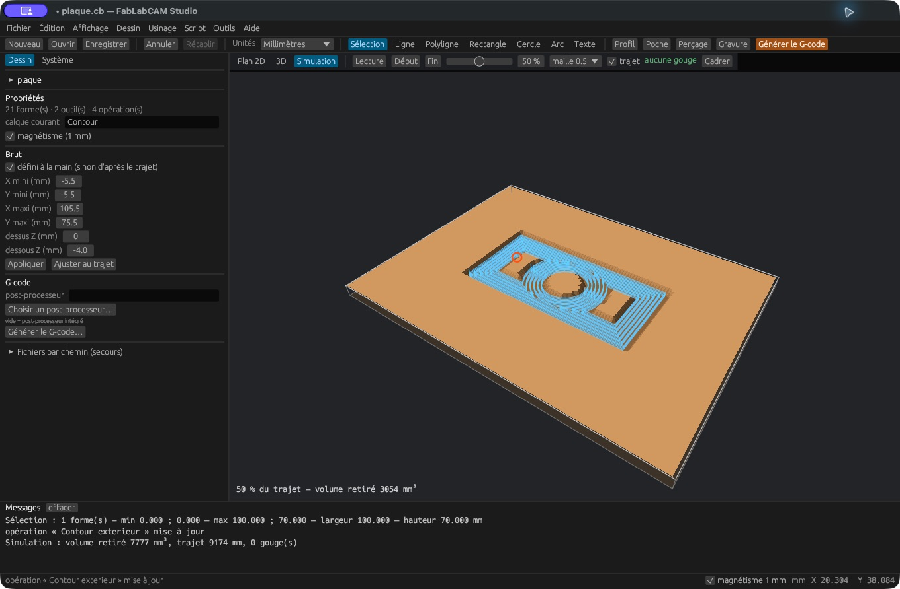

# Fichiers, import et export

[](../assets/screenshots/02-fichiers.png)

## Le projet natif `.cb`

**Nouveau** crée un projet vide. **Ouvrir** charge un fichier et **Récents** retrouve
les derniers projets. **Enregistrer** écrit au chemin courant ; **Enregistrer sous**
crée une copie. Le format `.cb` conserve le dessin ainsi que les outils, opérations,
paramètres et brut du projet FabLabCAM. Il reste le format recommandé pour reprendre
un travail d’usinage.

Le Studio accepte aussi le glisser-déposer de fichiers. Sur macOS, le bundle déclare
les extensions `.cb`, `.dxf` et `.svg` pour l’ouverture de documents.

## DXF et SVG

**Importer un dessin** apporte la géométrie d’un DXF ou SVG au projet ; l’ouverture
d’un document démarre depuis ce document. **Exporter le dessin** produit une sortie
DXF ou SVG. Les outils, opérations et paramètres machine ne sont pas transportés
par ces formats d’échange.

Ces lecteurs couvrent un sous-ensemble de dessin 2D. Un DXF peut contenir des entités,
blocs ou objets non gérés ; un SVG peut contenir du texte non vectorisé, des effets ou
des éléments non géométriques. Vérifiez les messages, les dimensions, le nombre de
formes et les contours après import. Exportez les textes en contours depuis votre
éditeur d’origine si nécessaire. Ne supposez pas une conservation intégrale d’un
fichier tiers complexe.

### Import SVG corrigé en 0.7.1

La version 0.7.0 pouvait désassembler un SVG qui contient des transformations
de groupes, importer des formes de `defs` qui ne sont pas visibles et perdre des
segments utilisant des coordonnées scientifiques. Le suivi est dans
[#26](https://github.com/FabLabCAM/core/issues/26).

Depuis la version 0.7.1, le lecteur compose les
transformations des parents et des formes, exclut les ressources inutilisées et
lit les exposants. Les arcs restent circulaires sous rotation, échelle uniforme
et miroir ; une échelle différente en X et Y ou un biais produit une polyligne.
Un chemin ou une transformation invalide entraîne une erreur d'import.

Pour vérifier un SVG : importer dans un document vierge, utiliser **Cadrer**, puis
contrôler l'assemblage, les dimensions et les messages. Les textes doivent être
vectorisés. Les références `use`, masques, découpes, effets, SVG imbriqués et CSS
ne sont pas intégralement pris en charge. Un avertissement signifie que le résultat
peut être incomplet.

Les coordonnées restent dans les unités utilisateur du fichier : la conversion
générale entre pixels, millimètres et `viewBox` n'est pas incluse dans ce correctif.
Vérifiez les dimensions avant de créer les opérations d'usinage. Les exports où
les dimensions en mm correspondent au `viewBox`, comme le fichier signalé, gardent
directement leur échelle.

## Dialogues système et saisie par chemin

Les dialogues utilisent les services de l’OS : macOS, PowerShell sur Windows,
Zenity sous Linux. Le projet possède **Fichiers par chemin (secours)** : saisissez
un chemin, puis **Importer**, **Exporter CB**, **Exporter DXF** ou **Exporter SVG**.
Cette zone est utile si un dialogue système est indisponible. Elle ne fournit pas
le dialogue d’export G-code ; la [CLI](../reference/cli.md) peut produire ce fichier.

[](../assets/screenshots/18-brut.png)

## Conversion en ligne de commande

```sh
fablabcam info plaque.cb
fablabcam convert plaque.cb plaque.svg
fablabcam convert plaque.cb plaque.dxf
fablabcam convert dessin.svg dessin.cb
```

`convert` est une conversion de **dessin** : utilisez le Studio ou `script` pour
construire un projet d’usinage. Conservez toujours le `.cb` original lors d’un
échange DXF/SVG. Le G-code exporté est un résultat d’usinage, pas le projet éditable.

## Modèles et projets de meubles

Depuis 0.5.0, le module [Meubles](meubles.md) possède ses bibliothèques et formats :
`.fcm-template.json` pour les gabarits, `.fcm.json` pour les projets, ZIP pour les
dossiers de fabrication. Utilisez **Importer** dans cet espace pour analyser et
prévisualiser le document. Les plans CB/DXF/SVG exportés sont des géométries ;
leur ouverture ne reconstitue pas un meuble paramétrique.
