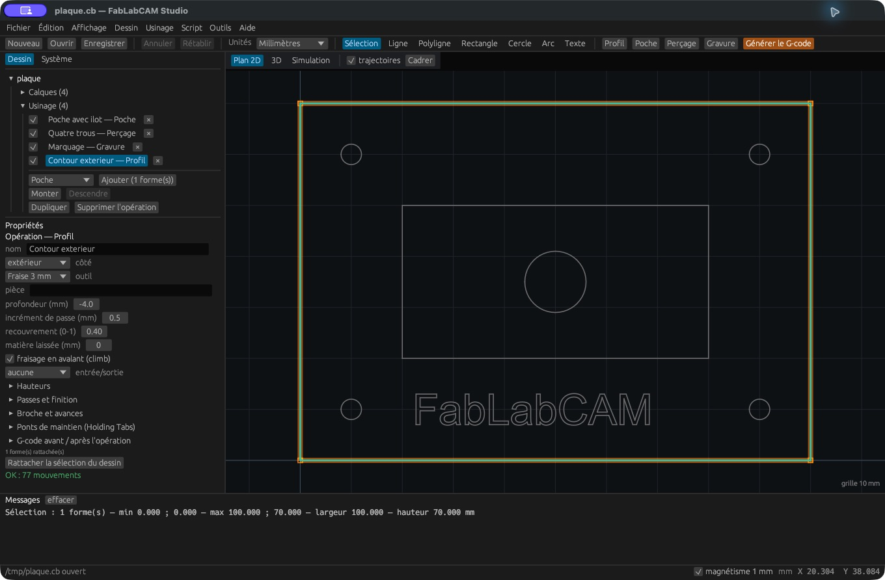
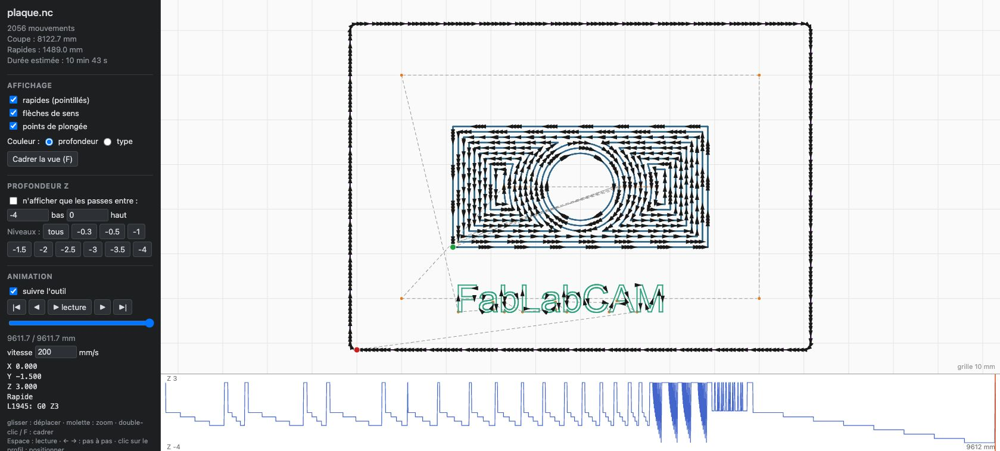

# Exporter et contrôler le G-code

[](../assets/screenshots/13-profil.png)

## Export depuis le Studio

1. Vérifiez l’ordre et l’activation des opérations.
2. Corrigez toute erreur de calcul dans leurs propriétés.
3. Sélectionnez le post-processeur dans les propriétés du projet ou **Système**.
   Un chemin vide utilise le post-processeur intégré.
4. Cliquez **Générer le G-code** (ou le raccourci d’export) et choisissez le fichier `.nc`.
5. Lisez le message de résultat et ouvrez le fichier produit pour contrôle.

Le post-processeur sélectionné est conservé dans les préférences locales.
Transmettez son fichier avec le projet si une autre personne doit reproduire
le programme avec exactement les mêmes réglages.

## Export en ligne de commande

```sh
fablabcam build plaque.cb -o plaque.nc
fablabcam build plaque.cb --post machine.cbpp -o plaque-machine.nc
```

`build` exploite les opérations enregistrées dans le projet. La commande
`gcode` crée un parcours à partir du dessin et des options passées en ligne de
commande ; elle ne remplace pas `build` pour rejouer la liste du projet.

## Inspecter le résultat indépendamment

```sh
fablabcam plot plaque.nc -o trace.svg
fablabcam plot plaque.nc -o trace.html
fablabcam-view plaque.nc
```

Le SVG fournit une vue de dessus et un profil de profondeur. La page HTML
ajoute navigation, zoom, animation et survol. Le viewer natif fournit une vue
interactive du G-code relu. Les rapides, plongées, directions et profondeurs
peuvent être affichés séparément. Essayez l’[exemple interactif](../examples/trajectoires.html).

## Points à contrôler

Contrôlez les unités, les origines et le repère, le sens de broche, les numéros
d’outils, les avances, les profondeurs, les déplacements rapides et les hauteurs
de dégagement. Vérifiez aussi le dialecte des arcs et cycles avec votre contrôleur.
Le post-processeur intégré n’est pas une configuration validée pour toutes les
machines. Le logiciel exporte un fichier ; il ne pilote pas directement la CNC.

## Mach3 : fichier chargé, lancement bloqué

Les photos de l'[issue #23](https://github.com/FabLabCAM/core/issues/23) montrent
« Arc de rayon nul » et « Le rayon de fin d'arc diffère de celui de début d'arc ».
L'arrivée d'un micro-arc coïncide avec son centre après arrondi à trois décimales.
Ce défaut apparaît 38 fois dans chacun de trois fichiers KO ; il est absent des
trois références et du quatrième KO, qui dépend en revanche du mode IJ initial.

Le correctif en cours vérifie les coordonnées après formatage : les arcs qui
deviennent dégénérés sont subdivisés en G1 depuis la trajectoire non arrondie,
selon la précision de sortie. Les cercles représentables, les arcs majeurs,
l'avance et la profondeur hélicoïdale sont conservés. Le validateur rejette
également un rayon final nul même si l'écart des rayons est sous la tolérance.
Ces changements sont dans la [PR #25](https://github.com/FabLabCAM/core/pull/25),
préparés pour la préversion 0.7.1-rc.1 ; ils sont absents de la version stable 0.7.0.

Dans la version 0.7.0, le préambule intégré ne déclare pas le mode des centres IJ
et n'annule pas les compensations et cycles précédents. Pour rendre ces modes
explicites, le [post-processeur de diagnostic](../examples/mach3-explicit-modes.cbpp)
est utilisable avec cette version, dans **Système → Post-processeur** ou en CLI :

```sh
fablabcam build plaque.cb --post mach3-explicit-modes.cbpp -o plaque-modes.nc
```

Il conserve les réglages d'usinage et écrit avant mouvement
`G21 G90 G17 G94 G40 G49 G80 G91.1` (G20 en pouces). Il ne change ni l'origine
de travail, ni le numéro d'outil, ni la demande de changement M6. Le correctif
des valeurs intégrées est en cours dans #23 ; il n'est pas livré en 0.7.0.
**Ce gabarit ne corrige pas les arcs dégénérés** : une copie ne changeant que
le préambule conserve l'erreur photographiée. Il sert uniquement à isoler
l'effet des modes.

Pour `lyon3.v1`, l'analyse dédiée reproduit un refus du premier arc (ligne
physique 145) si Mach3 interprète les centres IJ en mode absolu. G90 ne règle
pas ce mode : le programme utilise des centres incrémentaux et doit déclarer
G91.1. L'ajout de cette seule commande permet d'analyser les 1 072 arcs sans
erreur, depuis les deux modes IJ initiaux, avec les mouvements inchangés.
Le correctif d'initialisation de la PR couvre ce cas dans les trois exports.
Le 4 novembre 2026, l'utilisateur confirme que
`lyon3.v1.IJ_INCREMENTAL_A_TESTER.nc` fonctionne dans Mach3. Comme cette copie
ajoute seulement G91.1, le retour confirme l'efficacité du mode IJ explicite
pour ce fichier. Le détail de l'essai n'est pas précisé ; les trois autres
copies corrigeant les arcs dégénérés restent à confirmer.

**Limite de la 0.7.0 :** son backplot confond G91.1 avec G91, ce qui déforme
l'aperçu et la simulation d'un fichier contenant ce mode explicite. Le gabarit
ci-dessus est destiné au diagnostic de l'export ; la relecture doit être faite
dans un interpréteur qui distingue ces modes. La correction du backplot est
incluse dans le travail de #23 et n'est pas encore publiée.

Pour vérifier le correctif sur cette installation, recharger la copie
`ARCS_A_TESTER` du fichier concerné et relever la barre d'état pendant sa lecture,
sans lancer l'usinage. Ces copies remplacent uniquement les micro-arcs invalides
par un G1 à la même arrivée et complètent le préambule ; elles ne reconstituent
pas la géométrie perdue par l'ancien arrondi. Un manifeste décrit les changements.
Elles restent à confirmer dans Mach3. L'absence d'erreur au chargement et la
validation des paramètres d'usinage sont deux vérifications distinctes.

Le [manuel Mach3 Mill](https://www.machsupport.com/wp-content/uploads/2013/02/Mach3Mill_1.84.pdf)
accepte LF et CRLF (§10.5) et distingue G90 de G90.1/G91.1 (§10.7.26).
Une analyse statique sans erreur de rayon ne prouve pas que Mach3 pourra lancer
le programme avec ses macros et ses paramètres locaux.

La simulation du projet et la relecture du G-code sont complémentaires : une
commande ajoutée par un post-processeur peut avoir un effet que le simulateur du
projet ne représente pas. Voir la [référence des post-processeurs](../reference/postprocesseurs.md).

## Commandes du backplot interactif

[](../assets/screenshots/23-backplot.png)

Les cases **rapides**, **flèches de sens** et **points de plongée** contrôlent
les annotations. La couleur peut représenter la profondeur ou le type de
mouvement. Pour isoler une passe, cliquez son niveau Z ou activez les bornes
**bas / haut** ; **tous** retire ce filtre.

Glissez pour déplacer la vue, utilisez la molette pour zoomer et `F` ou un
double-clic pour cadrer. Le profil inférieur représente Z au long du parcours ;
un clic permet de positionner l’animation. Les boutons début/fin et pas à pas,
le curseur et la vitesse en mm/s contrôlent la lecture. `Espace` lance ou arrête
la lecture ; les flèches gauche/droite avancent pas à pas. **suivre l’outil**
maintient la vue sur la position courante. Le panneau affiche les coordonnées,
le type de déplacement et la ligne G-code correspondante.

La durée affichée est une estimation à partir des mouvements et avances
interprétés ; elle ne représente pas les accélérations et toutes les pauses
d’un contrôleur réel.

## Contrôler un programme avec un profil de machine

Depuis la v0.3.0, la commande `fablabcam machine validate` produit un rapport
lié aux limites et au dialecte d’un profil JSON. Voir le [guide des machines](machines.md).
Le backplot conserve son rôle de visualisation ; l’analyse statique expose
séparément les erreurs et les constructions non interprétées.
