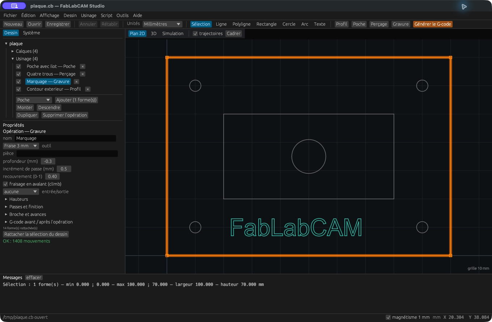

# Gravure

La **Gravure** suit les tracés sélectionnés à la profondeur demandée. Elle
convient aux lignes ouvertes, polylignes et contours de texte. Contrairement
au profil extérieur/intérieur, elle travaille sur le tracé lui-même.

1. Sélectionnez toutes les lignes à graver.
2. Cliquez **Gravure** et choisissez l’outil.
3. Réglez la profondeur, l’incrément et les avances.
4. Contrôlez les entrées et la hauteur de dégagement.
5. Inspectez la forme de l’outil et la matière retirée en simulation.

Une fraise en V influence la largeur simulée selon sa profondeur et son angle.
La fonction n’est pas une stratégie de V-carving à profondeur variable : elle
ne calcule pas automatiquement la profondeur pour remplir une largeur de lettre.
Le texte vectorisé forme généralement le pourtour des lettres, pas un tracé
monoligne. Pour remplir une région fermée, étudiez plutôt une poche.

Dans la plaque d’exemple, le marquage est à Z −0,3 mm. Cette valeur illustre le
réglage ; elle n’est pas une recommandation universelle pour un matériau.
