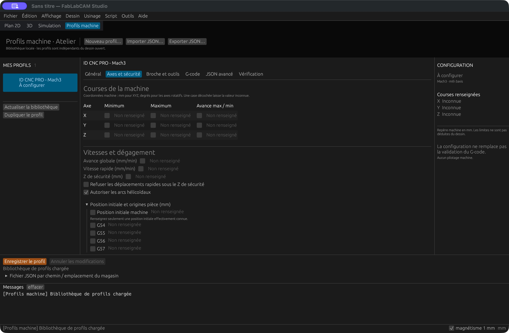
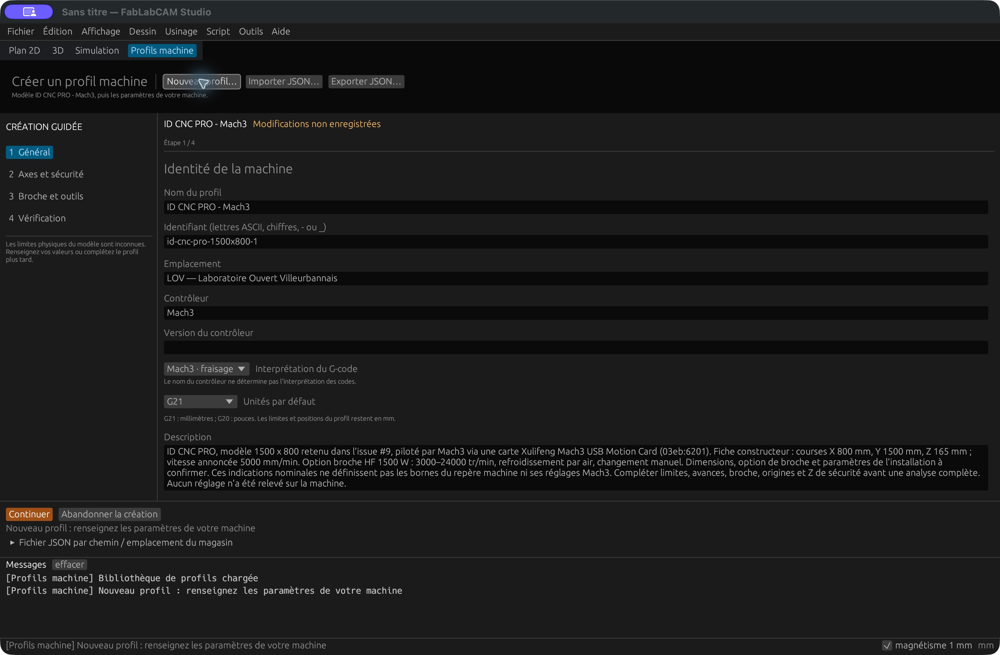

# ID CNC PRO - Mach3 : modèle par défaut

Depuis **FabLabCAM 0.4.1**, **ID CNC PRO - Mach3** est le modèle de création
des profils du Studio et de la CLI. Il répond à la première machine désignée
dans l’[issue #9](https://github.com/FabLabCAM/core/issues/9#issuecomment-6608555828) :
l’ID CNC PRO du Laboratoire Ouvert Villeurbannais, modèle 1500 × 800.

## Dans le Studio

Ouvrez **Outils → Profils machine · Atelier**. Une bibliothèque vide reçoit
automatiquement ce profil et le sélectionne. Son état initial est **À configurer**.
Si vous possédez déjà des profils, cliquez sur **Nouveau profil…** pour partir
de ce modèle. L’assistant propose un identifiant distinct ; renseignez vos
paramètres et enregistrez. Une mise à jour ne remplace aucun profil existant.





Captures réelles : **FabLabCAM Studio 0.4.1**, macOS Apple Silicon,
3 novembre 2026, bibliothèque de démonstration vide au premier lancement.

La [procédure Atelier](profils-studio.md) décrit les formulaires, la création
guidée, l’édition du JSON, les échanges et la gestion des conflits.

## Exemple JSON et CLI

Téléchargez [id-cnc-pro.json](../examples/machines/id-cnc-pro.json), également
fourni dans les paquets sous `profiles/` (dans les ressources de l’application
sur macOS). Son identifiant est **`id-cnc-pro-1500x800`**.

Vous pouvez aussi créer le même modèle depuis la CLI :

```sh
fablabcam machine profile init id-cnc-pro.json
fablabcam machine validate machine-valid.nc --profile id-cnc-pro.json
```

La création refuse de remplacer un fichier existant. Avec le
[programme synthétique](../examples/machines/machine-valid.nc), le modèle initial
produit un [rapport incomplet](../examples/machines/id-cnc-pro-report.json)
(`incomplete`, code de sortie 2), car les réglages locaux ne sont pas renseignés.
Les analyses continuent de demander un profil explicite avec `--profile`.

## Caractéristiques connues et réglages à relever

La [fiche ID Conception](https://id-conception.fr/cnc/pro) annonce pour la version
1500 × 800 des courses X de 800 mm, Y de 1500 mm et Z de 165 mm, et une vitesse
de 5000 mm/min. L’option broche HF 1500 W est décrite avec 3000–24000 tr/min,
refroidissement par air et changement manuel. Ces indications figurent dans
la description du profil ; l’option réellement montée reste à confirmer.

Le [wiki du LOV](https://labovilleurbanne.fr/dokuwiki/equipement:cnc:idcncpro)
identifie une carte Xulifeng « Mach3 USB Motion Card ». Le profil conserve
la sémantique Mach3 Mill et propose des conventions initiales en millimètres.
Ces conventions sont un modèle à adapter, pas une lecture de la configuration Mach3.

Les courses ne donnent ni les coordonnées min/max après homing ni le sens des axes.
Les bornes, avances par axe et globale, vitesse rapide, broche, origines pièce,
position initiale et Z de sécurité restent donc absents. Complétez-les à partir
des réglages de votre installation. Vérifiez également la version de Mach3,
les macros M6, le post-processeur, les outils et les commandes d’arrosage.

Les réglages de coupe proposés dans le
[guide Kiri:Moto du LOV](https://labovilleurbanne.fr/dokuwiki/equipement:cnc:kiri-moto)
dépendent du matériau et de l’outil : ce ne sont pas les vitesses maximales machine.
Le profil générique `mach3-mill.json` et l’exemple fictif `mach3-mill-demo.json`
restent disponibles dans le [guide de validation](machines.md).
