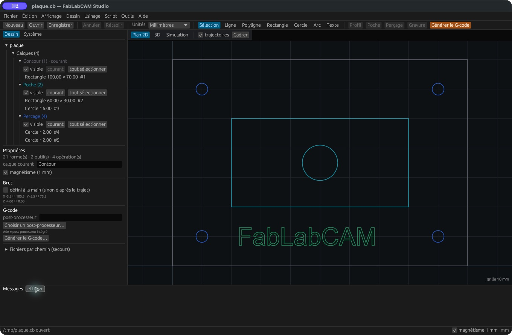

# Interface, navigation et calques

## Se repérer

| Zone | Rôle |
|---|---|
| Menu et barre d’outils | Fichiers, annulation, unités, dessin, création d’opérations, G-code |
| Onglet **Dessin** | Arbre du projet, calques, opérations et propriétés de la sélection |
| Onglet **Système** | Table d’outils, bibliothèque et post-processeur |
| Zone centrale | Plan 2D, résultat 3D ou simulation |
| **Messages** | Résultats d’action, dimensions, erreurs et bilan de simulation |
| Barre inférieure | État courant, magnétisme, coordonnées du pointeur |

## Naviguer dans le plan

- Molette : zoom ; bouton du milieu maintenu : déplacement de la vue.
- `F`, double-clic dans le plan ou **Cadrer** : adapter le dessin à la fenêtre.
- **trajectoires** : afficher/masquer les parcours calculés.
- `1`, `2`, `3` : plan, 3D, simulation, lorsque vous ne saisissez pas de texte.

En 3D, glissez dans la vue pour tourner autour du brut ; la molette zoome.
**Cadrer** réinitialise le cadrage. Ces gestes modifient la caméra, pas le dessin.

## Calques

Dépliez **Calques** dans l’arbre. Chaque calque possède un état **visible**, un
bouton **courant** et **tout sélectionner**. Le calque courant reçoit les nouvelles
formes. Saisissez un nom dans les propriétés du projet pour choisir le calque des
prochaines créations ; il apparaît lorsque vous y ajoutez une forme.

Pour déplacer des formes vers un autre calque, sélectionnez-les puis utilisez
**déplacer vers le calque** dans leurs propriétés. Masquer un calque facilite
la sélection ; ce n’est pas une commande de désactivation des opérations.
Désactivez les opérations avec leur case dans **Usinage**.

## Sélection et propriétés

Cliquez un objet dans le plan ou l’arbre ; `Maj` + clic ajoute à la sélection.
Les objets sélectionnés sont orange. Les informations de dimensions et de limites
apparaissent dans les propriétés et la console. Cliquez le nom du projet pour
retrouver les réglages généraux, le brut et les exports.

**Annuler** et **Rétablir** portent sur les modifications du projet. Les outils et
opérations existants s’enregistrent dans l’état du projet à la fin de la saisie ;
les propriétés géométriques qui possèdent **Appliquer** attendent ce bouton.
Un point dans le titre indique un projet modifié : enregistrez le `.cb` pour
écrire les changements sur disque.

## Unités et magnétisme

La barre d’outils bascule entre millimètres et pouces. La géométrie interne reste
exprimée en millimètres ; les longueurs affichées sont converties et le G-code
utilise les unités choisies. Vérifiez toujours le code d’unités exporté.
Le magnétisme arrondit les positions au pas réglé dans les préférences ; désactivez-le
pour positionner librement. Les coordonnées numériques permettent une saisie précise.
