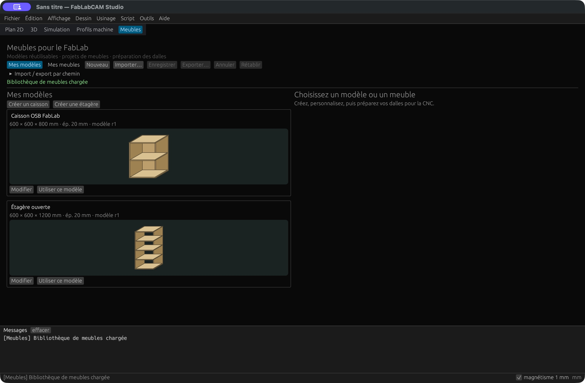
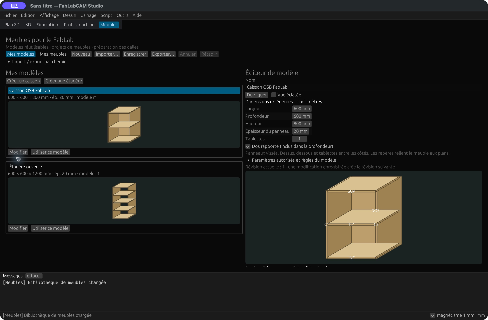
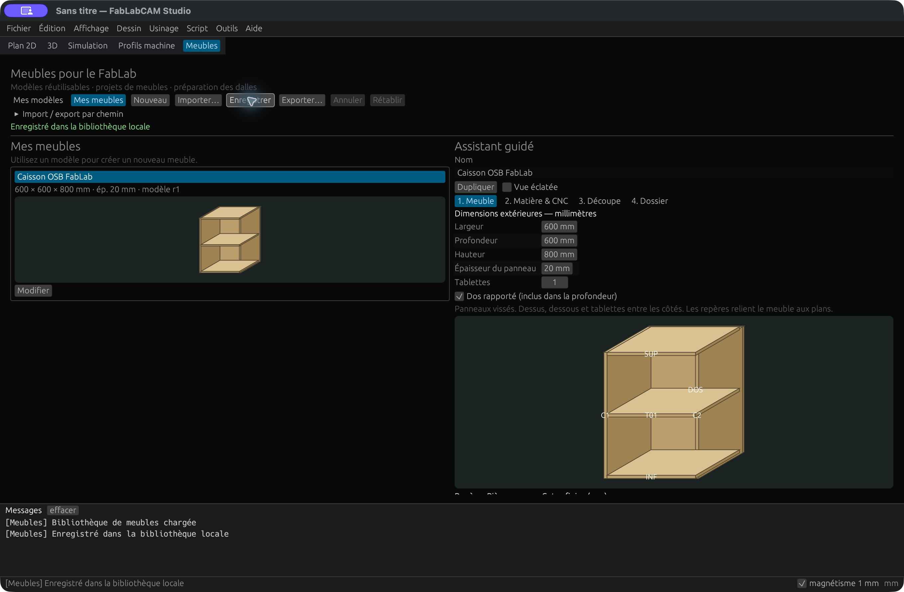
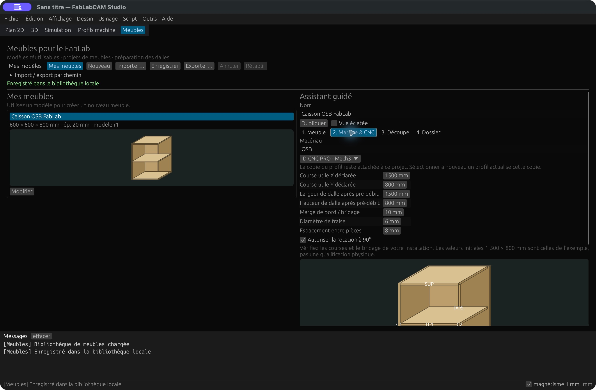
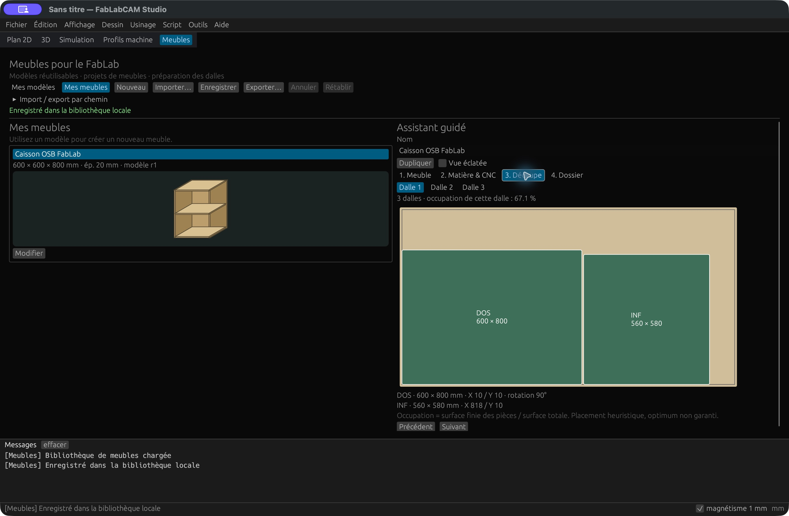
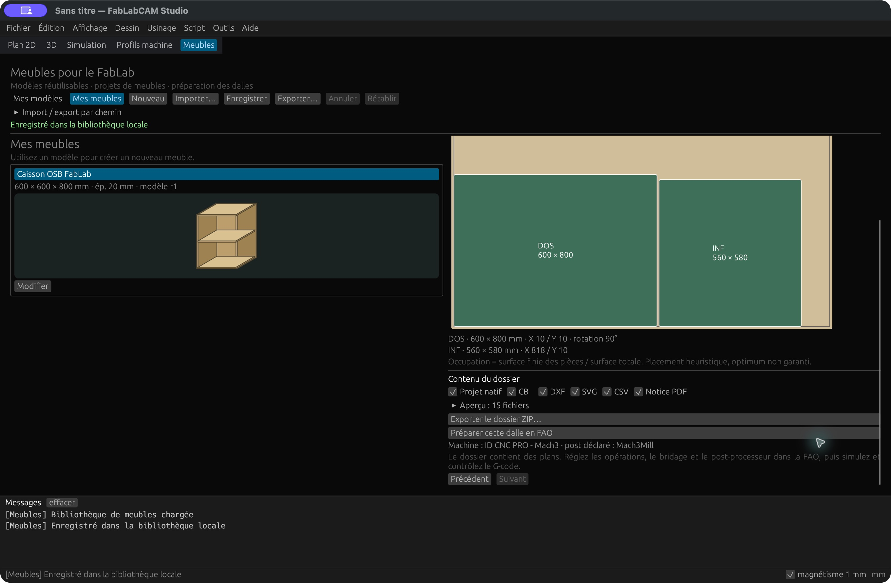
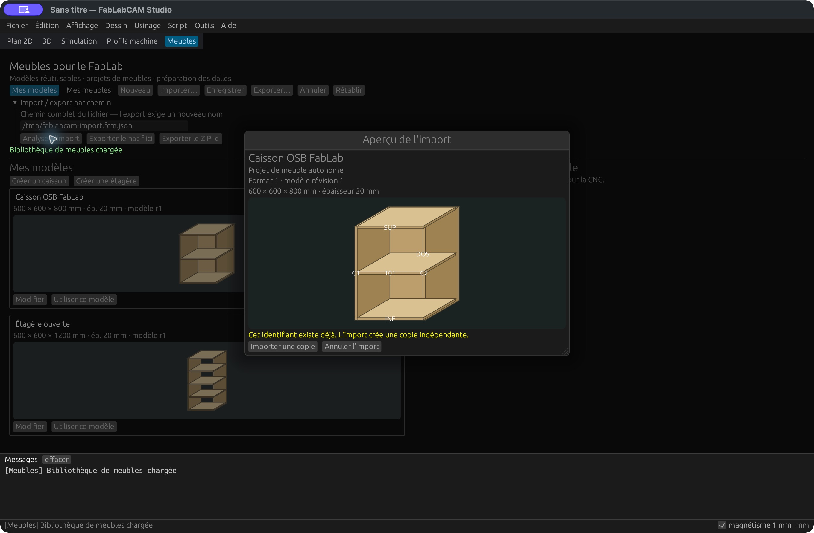

# Meubles paramétriques pour le FabLab

Depuis **FabLabCAM 0.5.0**, l'onglet **Meubles** permet de préparer un caisson ou
une étagère à partir de panneaux rectangulaires. Le parcours conserve les repères
des pièces depuis l'aperçu du meuble jusqu'aux plans de découpe.

## Modèle et meuble : deux documents

| Bibliothèque | Document | Usage |
|---|---|---|
| **Mes modèles** | Gabarit réutilisable, valeurs par défaut, limites et révision | Créer plusieurs meubles avec les mêmes règles |
| **Mes meubles** | Projet avec dimensions, matière, machine et dalles | Préparer une fabrication précise |

[](../assets/screenshots/35-meubles-modeles.png)

Choisissez **Créer un caisson** ou **Créer une étagère**, donnez un nom au modèle
et réglez ses dimensions. **Paramètres autorisés et règles du modèle** expose les
limites et les calculs. **Enregistrer** conserve le document dans la bibliothèque
locale ; **Exporter** crée un fichier partageable. Après enregistrement,
**Dupliquer** crée une copie avec un nouvel identifiant.

[](../assets/screenshots/36-meubles-editeur.png)

Une modification enregistrée augmente la révision du modèle. Un meuble déjà créé
conserve sa propre copie du modèle et ses paramètres. Il ne change pas lorsqu'un
autre utilisateur modifie le modèle d'origine. Un nouveau meuble reçoit les
valeurs de la révision choisie.

## Créer un meuble en quatre étapes

Dans **Mes modèles**, cliquez sur **Utiliser ce modèle**. Le nouveau projet
s'ouvre dans l'assistant et rejoint **Mes meubles** après enregistrement.

### 1. Meuble

Saisissez les dimensions extérieures dans l'ordre **largeur × profondeur × hauteur**,
en millimètres, puis l'épaisseur, le nombre de tablettes et la présence du dos.
L'aperçu peut être assemblé ou éclaté. Le tableau indique les cotes finies et les
repères stables : C1/C2, SUP, INF, T01… et DOS.

[](../assets/screenshots/37-meubles-assistant.png)

La V1 utilise des panneaux vissés à chants droits. Le dessus, le dessous et les
tablettes sont entre les côtés. Le dos rapporté est **inclus dans la profondeur
extérieure**. Les tablettes divisent la hauteur intérieure en espaces égaux.

**Annuler / Rétablir** agit sur les modifications du document. Un changement de
document ou la fermeture de l'application protège les modifications non
enregistrées : enregistrer, abandonner ou rester sur le document.

### 2. Matière & CNC

Choisissez le matériau et un profil de l'[Atelier](profils-studio.md), puis indiquez :

- les courses utiles X/Y déclarées pour ce travail ;
- la taille de la dalle chargée, **après pré-débit** du panneau acheté ;
- les marges de bord et de bridage, le diamètre de fraise et l'espacement ;
- l'autorisation de tourner les pièces de 90°.

[](../assets/screenshots/38-meubles-matiere-cnc.png)

Les valeurs initiales de **1 500 × 800 mm** servent au scénario d'exemple.
Vérifiez votre installation : elles ne renseignent pas les limites physiques
absentes du profil ID CNC PRO. Les dimensions de dalle ne peuvent pas dépasser
les courses utiles déclarées ni les limites connues du profil. Marge et
espacement doivent être au moins égaux au diamètre de fraise.

Le projet conserve une copie du profil choisi. Pour reprendre une configuration
actualisée, sélectionnez à nouveau ce profil dans la liste du projet.

### 3. Découpe

Le placement rectangulaire se recalcule avec les paramètres courants. Sélectionnez
une dalle pour voir ses pièces, rotations et coordonnées. Le taux d'occupation
est la **surface finie des pièces divisée par la surface totale de la dalle**.

[](../assets/screenshots/39-meubles-decoupe.png)

L'algorithme est une heuristique déterministe : il ne garantit pas le nombre
minimal de dalles. Une pièce trop grande ou un réglage incompatible bloque le
dossier complet. Il n'y a ni raccord automatique ni usinage par indexation.

### 4. Dossier et FAO

Choisissez les formats, ouvrez la liste des fichiers, puis utilisez
**Exporter le dossier ZIP** pour choisir la destination.

[](../assets/screenshots/40-meubles-dossier.png)

| Fichier | Contenu |
|---|---|
| `meuble.fcm.json` | Copie native modifiable, facultative dans le ZIP |
| `dalle-01.cb`, `.dxf`, `.svg`… | Plans par dalle ; cotes en mm et repères |
| `liste-de-debit.csv` | Pièces, dimensions, épaisseur, dalle et placement |
| `notice-montage.pdf` | Ordre d'assemblage, repères et hauteur des tablettes |
| `profil-machine.json` | Copie du profil machine du projet |
| `placement.json`, `LIRE-MOI.txt` | Placement calculé et consignes de préparation |

**Préparer cette dalle en FAO** charge sa géométrie, son brut et une fraise dans
le Studio. Un dessin en cours est protégé avant remplacement. Les opérations
restent à créer : régler outil, avances, profondeurs, ponts et bridage, puis
utiliser la [simulation](simulation.md) et le [post-processeur](gcode.md).

Le profil machine reste associé à la dalle, y compris après enregistrement et
réouverture du `.cb` dans FabLabCAM. L'Atelier propose **Associer ce profil à la
dalle FAO** pour actualiser explicitement cette copie. Le post-processeur déclaré
est affiché ; choisissez le post adapté dans la FAO. Le nom du profil ne remplace
pas cette vérification.

Pour une dalle associée à une machine, l'export G-code natif et `fablabcam build`
exigent des opérations calculées et un rapport d'analyse **valide** avec le
profil attaché. Un profil incomplet bloque cet export. Les plans du ZIP restent
disponibles pour préparer le travail. Une analyse statique ne certifie ni les
collisions, ni le maintien des pièces, ni une machine réelle.

## Importer et partager

- `.fcm-template.json` : modèle réutilisable, indépendant d'une CNC ;
- `.fcm.json` : meuble autonome, avec copie du modèle et du profil machine.

**Importer** analyse le format, sa version et ses paramètres, puis affiche un
aperçu avant l'ajout. Si l'identifiant existe, **Importer une copie** conserve
l'original. Une version inconnue ou un fichier invalide n'altère pas la bibliothèque.

[](../assets/screenshots/41-meubles-import.png)

Les exports exigent un nouveau nom de fichier et ne remplacent pas un fichier
existant. Le volet **Import / export par chemin** permet de travailler sans
dialogue système. Les fichiers 2D CB/DXF/SVG restent des géométries : les importer
ne recrée pas automatiquement un meuble paramétrique.

## Exemple reproductible : caisson OSB

Configuration : **600 × 600 × 800 mm**, OSB **20 mm**, un dos et une tablette.

| Pièce | Nombre | Cotes finies |
|---|---:|---|
| Côtés | 2 | 800 × 580 mm |
| Dessus, dessous, tablette | 3 | 560 × 580 mm |
| Dos | 1 | 600 × 800 mm |

Avec des dalles **1 500 × 800 mm**, marge **10 mm**, fraise **6 mm**, espacement
**8 mm** et rotations autorisées, le résultat comporte **trois dalles**. Passer
la largeur à 700 mm donne des traversants/tablette de 660 mm et un dos de 700 mm.

Fichiers publics produits avec la CLI 0.5.0 :
[modèle](../examples/meubles/caisson.fcm-template.json),
[meuble autonome](../examples/meubles/caisson.fcm.json),
[dossier ZIP complet](../examples/meubles/fabrication.zip),
[plan SVG de la dalle 1](../examples/meubles/dalle-01.svg),
[liste de débit](../examples/meubles/liste-de-debit.csv) et
[notice PDF](../examples/meubles/notice-montage.pdf).

Dans un dossier vide, avec les binaires 0.5.0 :

```sh
fablabcam furniture template cabinet -o caisson.fcm-template.json
fablabcam furniture new caisson.fcm-template.json -o caisson.fcm.json
fablabcam furniture validate caisson.fcm.json
fablabcam furniture plan caisson.fcm.json
fablabcam furniture pack caisson.fcm.json -o fabrication.zip
```

`shelving` crée le gabarit d'étagère. `new` accepte `--width`, `--depth`, `--height`,
`--thickness`, `--shelves` et `--profile`. La CLI ne modifie pas la bibliothèque
du Studio : importez le fichier produit pour l'y ajouter.

## Limites et provenance

La V1 couvre les caissons et étagères rectangulaires vissés. Les assemblages usinés,
portes, tiroirs, quincaillerie, chutes et structures arbitraires restent hors
périmètre. Vis, avant-trous, ancrages, stabilité et charges admissibles ne sont
pas dimensionnés. Les projets natifs conservent les noms Unicode ; la notice
PDF utilise des libellés fixes en français et des repères.

Les captures 35 à 41 proviennent du Studio **0.5.0 sur macOS Apple Silicon** avec
un exemple synthétique. Les dialogues système peuvent différer selon l'OS.
[Issue #14](https://github.com/FabLabCAM/core/issues/14) ·
[Release 0.5.0](https://github.com/FabLabCAM/core/releases/tag/v0.5.0).
