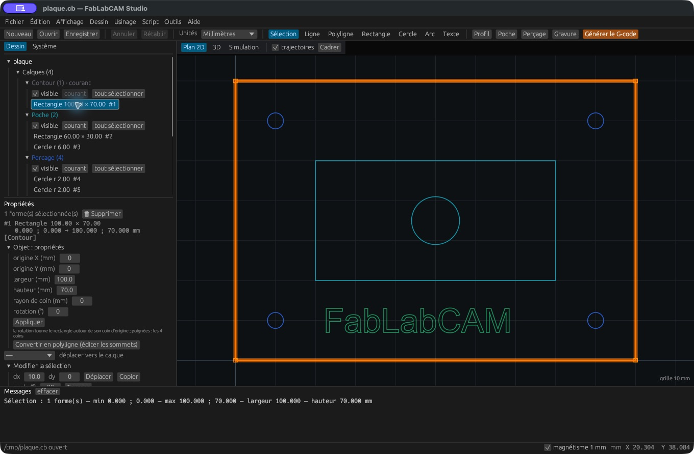
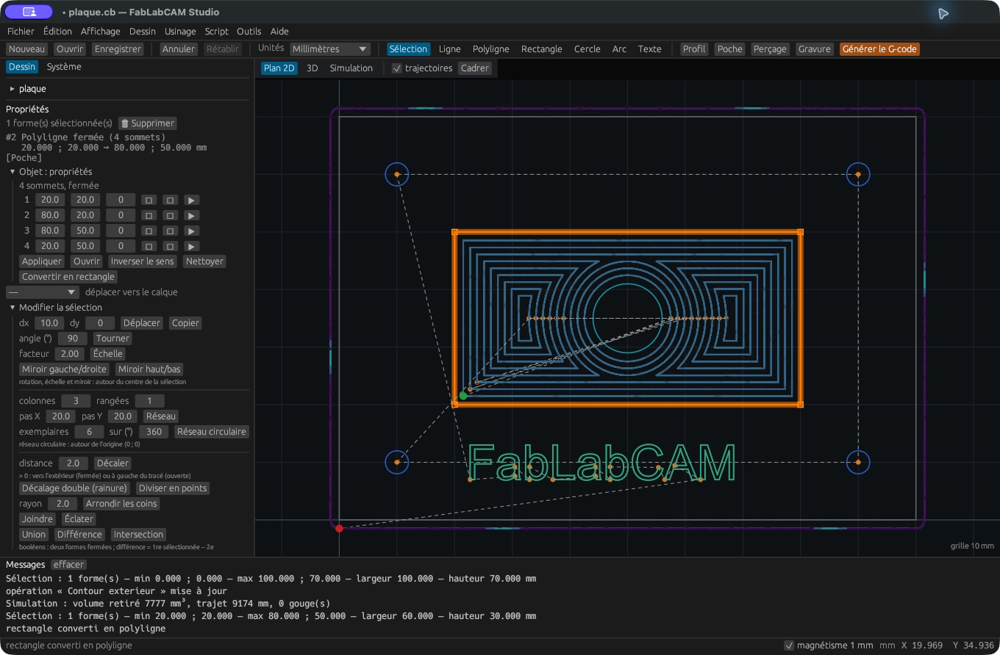

# Propriétés et édition des sommets

Sélectionnez **une seule forme**, puis ouvrez **Objet : propriétés**. Les champs
sont exprimés dans les unités affichées du projet. Cliquez **Appliquer** pour
valider une saisie géométrique ; l’action peut ensuite être annulée.

| Forme | Propriétés |
|---|---|
| Rectangle | Origine X/Y, largeur, hauteur, rayon de coin, rotation |
| Cercle | Centre X/Y, rayon ou diamètre |
| Arc | Centre X/Y, rayon, angle de début et balayage en degrés |
| Polyligne | Sommets X/Y, courbure de chaque segment et état ouvert/fermé |
| Point | Déplacement via les transformations de la sélection |

La rotation du **rectangle** se fait autour de son coin d’origine. La rotation
d’une **sélection**, dans le panneau de transformation, se fait autour du centre
de cette sélection. Ce sont deux commandes différentes.

## Passer du rectangle à la polyligne

**Convertir en polyligne (éditer les sommets)** rend les points modifiables
individuellement. Une polyligne reconnue comme rectangle peut revenir à un objet
rectangle avec **Convertir en rectangle**.

## Modifier une polyligne

Chaque ligne de la table représente un sommet. Modifiez X et Y, ou glissez sa
poignée dans le plan. La valeur de courbure (*bulge*) décrit le segment qui suit :
0 produit une ligne droite ; une valeur non nulle produit un arc. Les boutons
par sommet permettent d’insérer un point, de retirer le sommet ou de choisir le
point de départ du contour. Survolez un bouton pour lire sa fonction.

- **Ouvrir / Fermer** change la liaison entre le dernier et le premier sommet.
- **Inverser le sens** retourne l’ordre du parcours.
- **Nettoyer** retire les sommets en double.
- **Appliquer** valide les coordonnées et courbures saisies.

Gardez au moins une géométrie valide. Une poche demande des contours fermés ;
une gravure peut suivre des tracés ouverts. Après édition d’un contour rattaché
à une opération, contrôlez le recalcul et la simulation.
