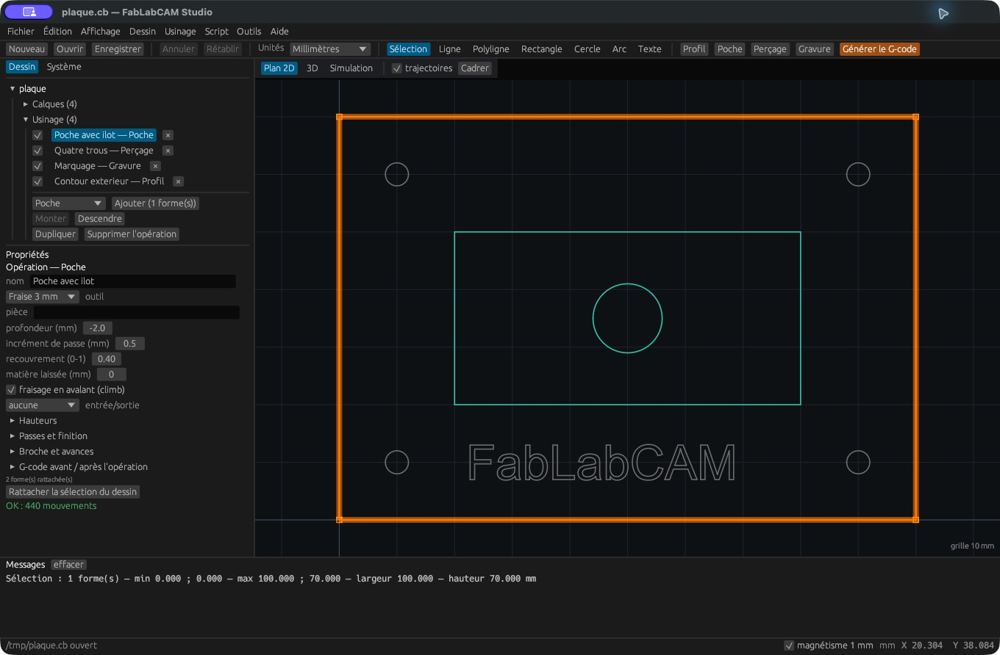

# Organiser les opérations

## Créer une opération

1. Sélectionnez les formes dans le plan ou dans l’arbre des calques.
2. Cliquez **Profil**, **Poche**, **Perçage** ou **Gravure** dans la barre d’outils.
3. Sélectionnez l’opération créée dans **Usinage**.
4. Choisissez son outil, sa profondeur et ses autres paramètres.
5. Vérifiez son résultat de calcul et sa trajectoire.

Le menu Usinage et le menu contextuel proposent les mêmes familles. Vous pouvez
également choisir le type dans la liste sous l’arbre, puis **Ajouter**.

## Ordre et activation

La case d’une opération l’active ou la désactive. **Monter** et **Descendre**
modifient l’ordre d’exécution. **Dupliquer** crée une variante ; **Supprimer
l’opération** retire l’opération et conserve le dessin. Le champ **pièce** sert
à organiser les opérations par pièce dans l’arbre ; ne le confondez pas avec
un changement automatique d’origine machine.

Les opérations sont exécutées dans l’ordre défini, avec les changements d’outil
nécessaires. Placez en général les opérations intérieures avant le détourage
qui libère la pièce ; adaptez l’ordre au bridage réel.

## Rattacher une nouvelle sélection

La liste de formes d’une opération est mémorisée. Sélectionnez les formes
souhaitées puis revenez à l’opération et cliquez **Rattacher la sélection du
dessin** pour remplacer son rattachement. Vérifiez le nombre de formes indiqué
et la trajectoire après modification.

## Lire le résultat de calcul

Un état **OK : … mouvements** signifie que le calcul a produit une trajectoire.
Une erreur indique une géométrie ou un paramètre à corriger. Si le panneau
précise que la trajectoire affichée date du dernier calcul valide, l’image est
ancienne : corrigez l’erreur avant l’export. L’absence d’erreur géométrique ne
valide pas les réglages d’usinage pour votre machine.

Les réglages communs sont détaillés dans [Entrées, passes et finition](parametres.md).
