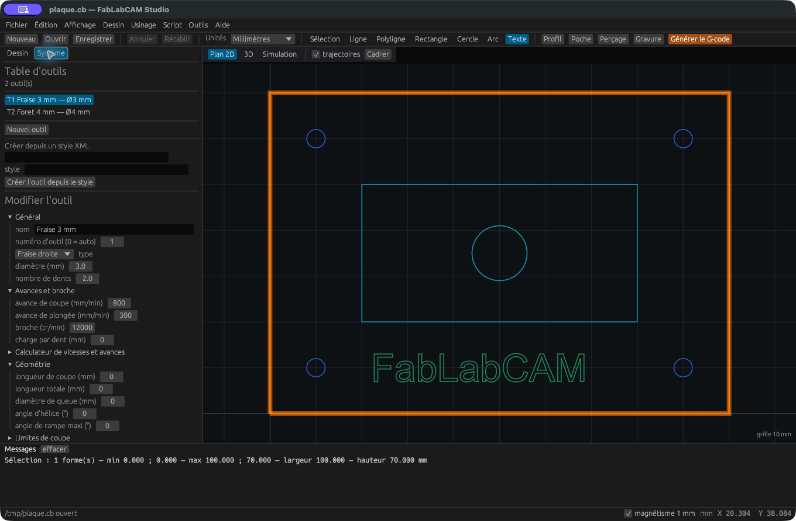
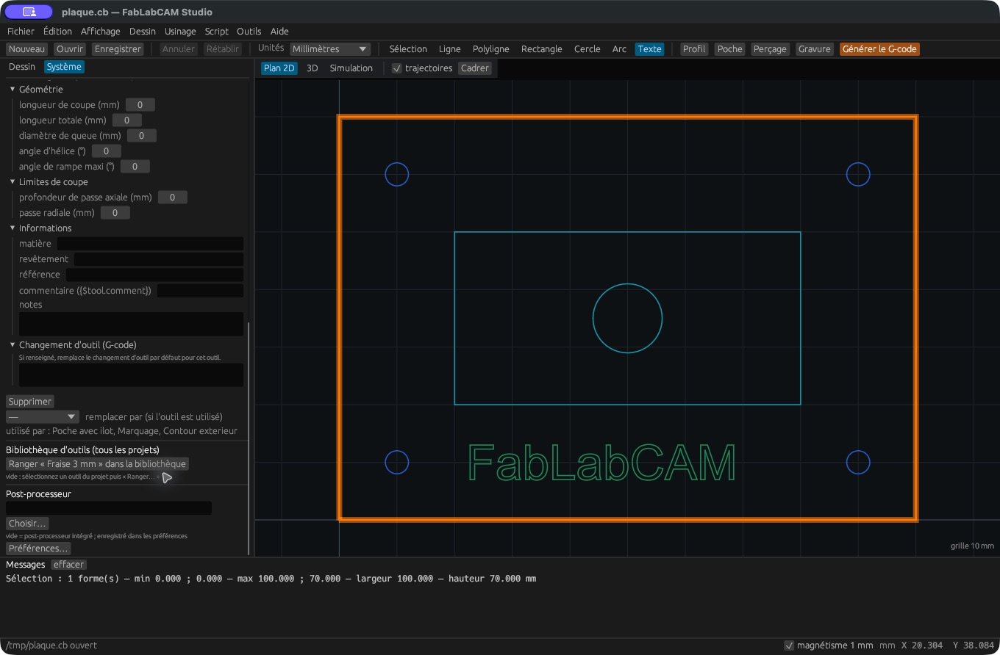

# Outils et bibliothèque

## Créer ou modifier un outil

Dans **Système**, cliquez **Nouvel outil**, renseignez les champs puis **Créer**.
Un outil existant est enregistré dans le projet à la fin de la saisie.
Le nom identifie l’outil utilisé par les opérations ; le numéro identifie le
changement d’outil dans le G-code. **0 = auto** choisit un numéro disponible.

| Groupe | Propriétés |
|---|---|
| Général | Nom, numéro, type, diamètre, nombre de dents |
| Avances et broche | Avance de coupe, plongée, vitesse de broche, charge par dent |
| Géométrie | Longueur de coupe, longueur totale, diamètre de queue, hélice, rampe maximale, angle du V |
| Limites de coupe | Profondeur axiale et passe radiale |
| Informations | Matière, revêtement, référence, commentaire et notes |
| Changement d’outil | G-code propre à cet outil, remplaçant le changement par défaut |

Les types proposés sont **fraise droite, fraise torique, fraise boule, foret et
fraise en V**. Le diamètre, les avances et la vitesse doivent être positifs.
Une fraise en V demande un angle strictement compris entre 0 et 180°.

Les longueurs, limites de coupe, hélice et angle de rampe sont essentiellement
**des informations enregistrées**, pas des contraintes automatiques du calcul
FAO. L’angle du V influence la simulation ; le commentaire et le changement
d’outil influencent le post-traitement. La fraise torique est simulée comme
une fraise droite : le rayon de coin n’est pas modélisé.

## Remplacer et supprimer

La fiche affiche les opérations utilisatrices. Pour supprimer un outil déjà
rattaché à des opérations, choisissez **remplacer par**, puis **Supprimer**.
Sans remplacement valide, l’application refuse la suppression. Contrôlez les
parcours après tout changement de diamètre ou de type.

## Bibliothèque partagée entre projets

Sélectionnez un outil du projet puis **Ranger … dans la bibliothèque**. Cette
commande conserve une copie réutilisable. **ajouter au projet** importe un outil
de la bibliothèque ; **×** le retire de la bibliothèque.

La bibliothèque est locale à votre compte, dans `outils.cb`, à côté des
[préférences](../reference/raccourcis.md). Elle n’est pas synchronisée en ligne.
Les projets conservent leurs propres outils ; une modification de bibliothèque
n’applique pas automatiquement les changements à tous les projets existants.

## Importer depuis un style XML

Dans **Créer depuis un style XML**, indiquez le chemin de la bibliothèque et le
nom du style, puis **Créer l’outil depuis le style**. Vérifiez le brouillon et
cliquez **Créer**. L’import reprend notamment diamètre, avances et broche ; il
ne constitue pas un import complet de toute stratégie machine.
