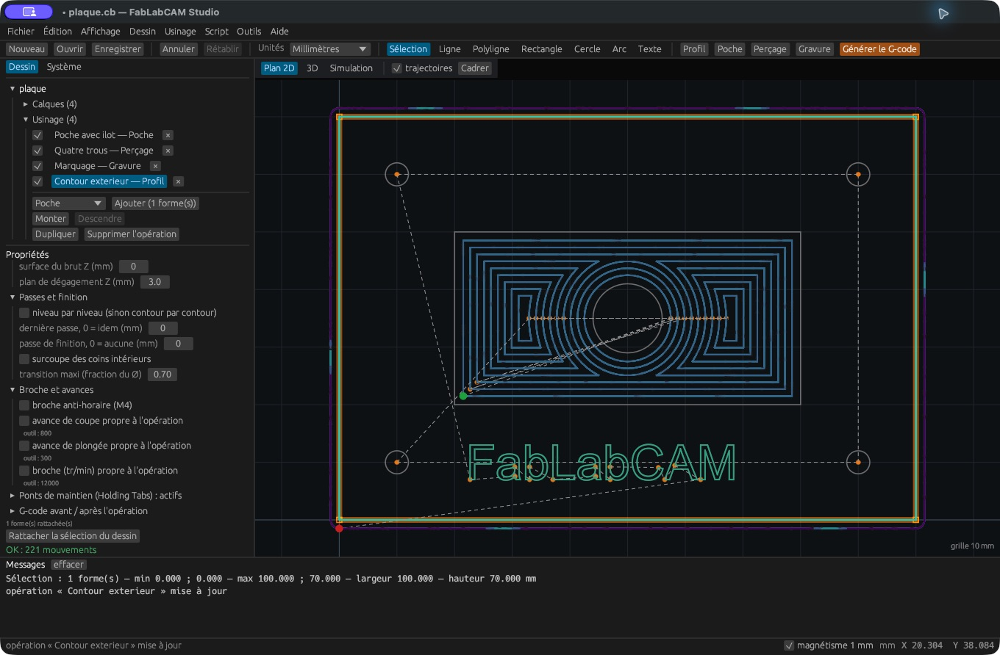

# Entrées, hauteurs, passes et finition

## Hauteurs et profondeur

| Paramètre | Interprétation |
|---|---|
| Surface du brut Z | Altitude du dessus utilisé pour le calcul |
| Profondeur | Altitude Z cible, généralement négative sous une surface à 0 |
| Plan de dégagement Z | Hauteur des déplacements de dégagement |
| Incrément de passe | Descente entre deux niveaux |
| Dernière passe | Incrément final spécifique ; 0 reprend l’incrément normal |

La profondeur est une **coordonnée Z cible**, pas une épaisseur positive.
Vérifiez sa cohérence avec la surface et le dessous du brut. La définition du
brut de simulation ne remplace pas automatiquement les hauteurs de chaque
opération.

## Entrée et sortie

**Aucune** utilise l’approche sans entrée spéciale. **Spirale** donne accès à
l’angle de rampe, avec 0 pour le comportement automatique. **Tangente** propose
un rayon, 0 utilisant le diamètre de l’outil. Les possibilités exactes dépendent
de la géométrie et de l’opération ; contrôlez les mouvements générés.

La CLI distingue `--lead-in` et `--lead-out`. Ne supposez pas qu’un nom de stratégie
suffit à garantir son adéquation à une fraise non plongeante ou à un espace étroit.

## Passes et finition

- **Niveau par niveau** change l’ordre des passes par rapport à contour par contour.
- **Passe de finition** réserve un passage latéral ; 0 la désactive.
- **Finition seulement à la profondeur finale** limite la finition au dernier niveau.
- **Surcoupe des coins intérieurs** est disponible sur le profil.
- **Transition maxi** limite les liaisons, en fraction du diamètre de l’outil.

Les champs affichés par le panneau commun n’ont pas nécessairement un effet sur
toutes les stratégies. La gravure suit ses lignes ; les réglages de vidage et de
finition latérale concernent surtout les profils et les poches. Vérifiez toujours
le parcours produit plutôt que de déduire son comportement du seul formulaire.

## Broche et avances

Par défaut, l’opération hérite de son outil. Cochez **avance de coupe propre**,
**avance de plongée propre** ou **broche propre** pour définir une valeur locale.
Décochez pour reprendre l’héritage. **Broche anti-horaire (M4)** change le sens
commandé. **Fraisage en avalant** contrôle le sens de parcours associé.

## G-code avant et après l’opération

Les champs d’en-tête et de pied insèrent du G-code autour de cette opération.
Utilisez-les pour des besoins explicitement connus du contrôleur ; ces lignes
peuvent modifier son état modal. Elles ne sont pas toutes interprétées par la
simulation. Inspectez le fichier exporté et les transitions entre opérations.
