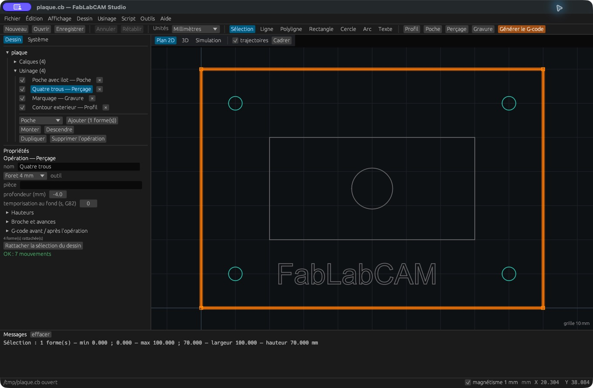

# Perçage

[](../assets/screenshots/11-percage.png)

Sélectionnez les points ou cercles représentant les trous, puis cliquez
**Perçage**. Choisissez un foret et une profondeur cible. Un cercle sert à
localiser le centre : son rayon dessiné ne transforme pas l’opération en
alésage circulaire. Le diamètre du foret détermine le trou simulé.

**Hauteurs** règle la surface et le plan de dégagement. **Broche et avances**
permet de remplacer les valeurs de l’outil. La **temporisation au fond**
active un comportement G82 lorsque le cycle et les paramètres le permettent.

## Cycles et picage

Le moteur gère le perçage simple, la temporisation et le picage. Le panneau
Studio 0.2.0 ne présente pas de champ d’incrément pour le perçage. Pour préparer
explicitement un picage à partir d’un dessin, utilisez la CLI et `--step` :

```sh
fablabcam gcode plaque.cb --op drill --layer Percage \
  --tool 4 --depth -4 --step 1 --clearance 3 -o trous.nc
```

Le mode par cycles peut produire G81/G82/G83 selon le besoin. L’option CLI
`--no-canned` développe les mouvements plutôt que d’utiliser les cycles.
Vérifiez le support des cycles et des plans de retour de votre contrôleur.
Une temporisation n’a pas d’effet avec un picage actif dans cette version.

La simulation visualise l’enlèvement de matière ; elle ne prédit pas l’évacuation
des copeaux, le guidage du foret ou le risque de casse.
