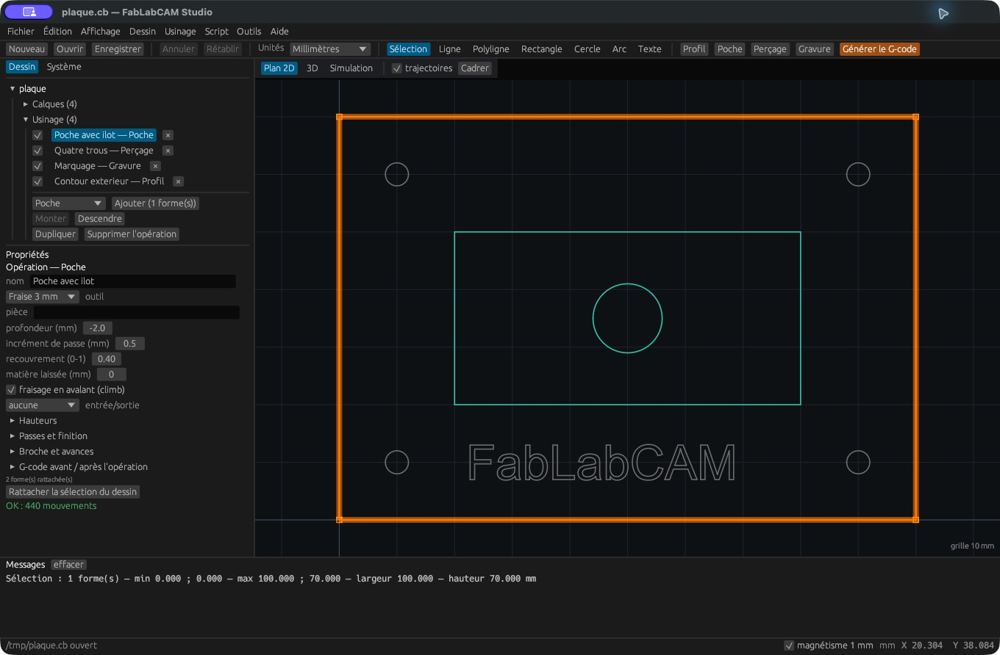

# Poche et îlots

Une **Poche** retire la matière à l’intérieur de contours fermés. Sélectionnez
la limite extérieure et tous les contours d’îlots, puis créez **une même
opération Poche**. Les contours contenus dans d’autres sont interprétés selon
leur imbrication pour conserver les îlots.

1. Vérifiez les fermetures et retirez les doublons inutiles.
2. Choisissez une fraise dont le diamètre passe dans les zones à vider.
3. Réglez la profondeur cible, l’incrément de passe et le recouvrement.
4. Définissez éventuellement une matière laissée et une finition.
5. Contrôlez le parcours autour des îlots et la matière restante en 3D.

Le champ **recouvrement (0–1)** pilote le pas latéral du calcul. Une valeur plus
faible produit des passages plus rapprochés et davantage de mouvements. Choisissez
une valeur adaptée à l’outil et à l’engagement autorisé.

**Niveau par niveau** traite les niveaux successivement ; sinon le calcul suit
l’ordre contour par contour. La transition maximale règle les liaisons entre
anneaux, en fraction du diamètre d’outil. Consultez les [paramètres communs](parametres.md)
pour les entrées, la dernière passe et les passes de finition.

Si la poche reste vide ou échoue, vérifiez d’abord les contours ouverts, les
intersections et le diamètre d’outil. Une région plus étroite que la fraise
ne peut pas être usinée entièrement. Une bonne visualisation des lignes ne
remplace pas l’examen de la matière restante.
