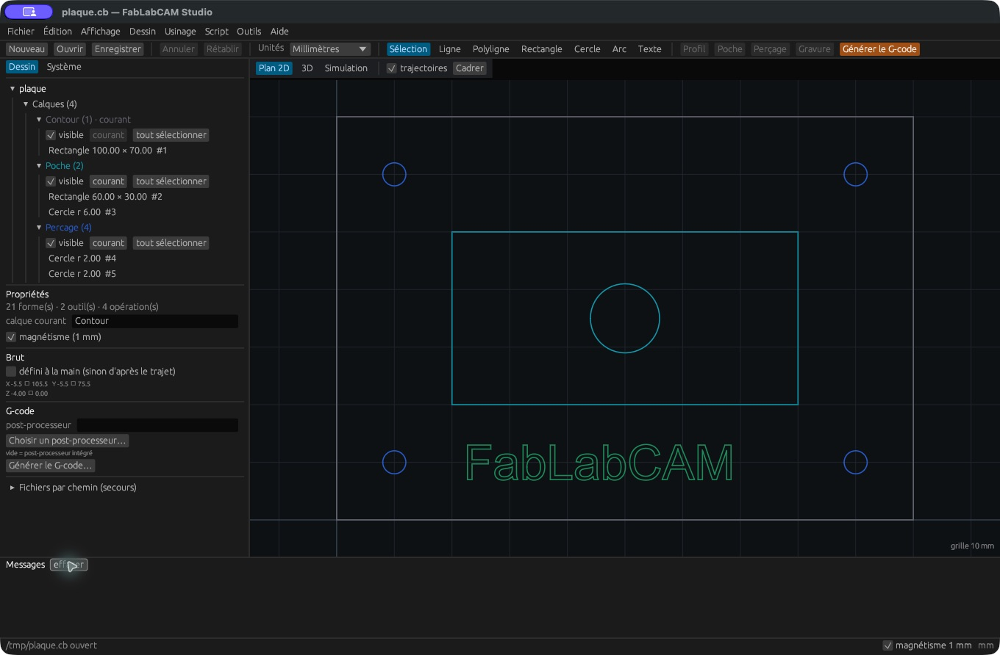
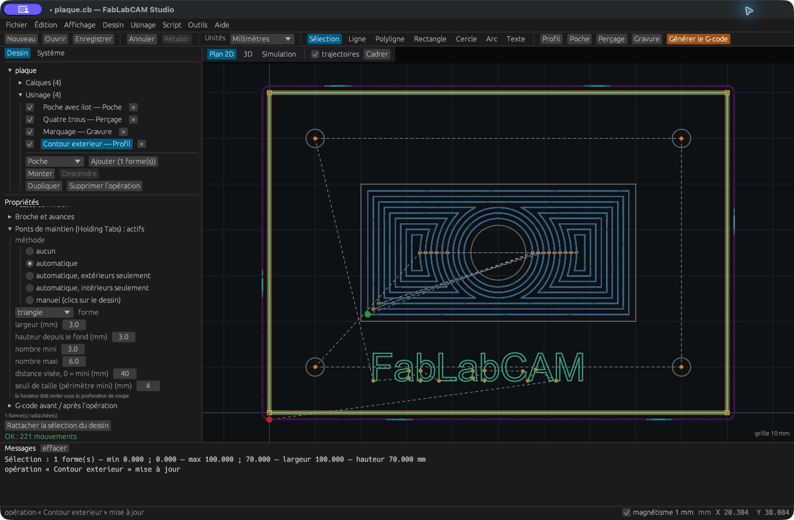
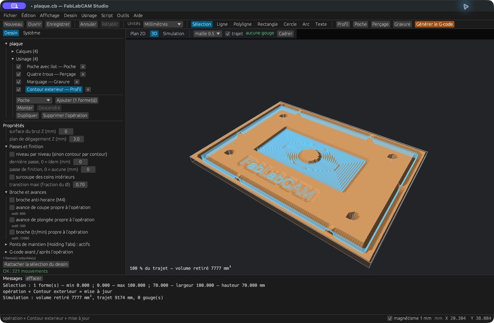

# Première pièce : une plaque avec poche et perçages

Ce tutoriel produit un dessin de **100 × 70 mm**, une poche avec îlot,
quatre trous et un marquage. Les valeurs servent à démontrer le logiciel.

## 1. Ouvrir l’exemple

Téléchargez [plaque.cb](../examples/plaque.cb), puis utilisez **Fichier → Ouvrir**.
Le dessin contient 21 formes, deux outils et quatre opérations. Les contours
du texte sont déjà enregistrés : aucune police supplémentaire n’est nécessaire
pour ouvrir ce fichier.

[](../assets/screenshots/01-interface.png)

Si le dialogue système ne s’affiche pas, sélectionnez le nom du projet,
dépliez **Fichiers par chemin (secours)**, saisissez le chemin du fichier puis
cliquez **Importer**. Cette action ouvre un projet `.cb` ; enregistrez vos
modifications courantes avant de l’utiliser.

## 2. Examiner la géométrie

| Calque | Géométrie |
|---|---|
| Contour | Rectangle de (0, 0) à (100, 70) |
| Poche | Rectangle de (20, 20) à (80, 50), cercle de centre (50, 35), rayon 6 |
| Percage | Centres (10, 10), (90, 10), (90, 60), (10, 60), rayon dessiné 2 |
| Gravure | Contours vectoriels de « FabLabCAM », hauteur 6 |

Cliquez une forme pour lire ses propriétés. `F` cadre le dessin ; la molette
zoome. Le rectangle et le cercle du calque Poche sont rattachés à **la même
opération**, ce qui préserve le cercle comme îlot.

## 3. Vérifier les outils et les opérations

Dans **Système**, examinez **Fraise 3 mm** et **Foret 4 mm**. Les avances et la
vitesse de broche fournies sont des valeurs de démonstration. Réglez-les selon
votre machine, votre matériau et vos outils.

| Ordre | Opération | Profondeur Z |
|---|---|---|
| 1 | Poche avec îlot | −2 mm |
| 2 | Quatre trous | −4 mm |
| 3 | Marquage | −0,3 mm |
| 4 | Contour extérieur | −4 mm |

Repliez **Calques** pour voir la branche **Usinage**. Sélectionnez une opération
pour la modifier. L’application recalcule à la fin de la saisie ; vérifiez
l’indication verte **OK** ou l’erreur éventuelle.

## 4. Ajouter des ponts si nécessaire

Pour explorer cette fonction, sélectionnez **Contour extérieur**, ouvrez
**Ponts de maintien** et choisissez **automatique**. Les captures suivantes du
guide montrent cette variante. Le fichier téléchargé ne contient pas de ponts :
ajustez leur taille et leur position en fonction de votre bridage, puis sauvegardez
la variante sous un autre nom.

[](../assets/screenshots/14-ponts.png)

## 5. Simuler

Sélectionnez **3D**, puis **Simulation**. Utilisez le curseur, **Début** et **Fin**.
Une maille de 0,5 mm convient pour une première inspection. Vous devez retrouver
la poche, l’îlot central, les trous et le contour. Une maille plus fine améliore
la précision au prix du temps et de la mémoire.

[](../assets/screenshots/16-vue-3d.png)

## 6. Sauvegarder et exporter

Utilisez **Enregistrer sous** pour conserver votre projet `.cb`, puis
**Générer le G-code** pour produire un fichier `.nc`. Contrôlez les unités,
l’origine, les profondeurs, le dégagement, les outils et le post-processeur avant
un essai machine. La simulation ne représente ni les brides ni la cinématique
complète de la machine.

## Reproduire le dessin par script

Téléchargez [plaque.rhai](../examples/plaque.rhai), puis :

```sh
fablabcam script plaque.rhai -o plaque.cb
fablabcam build plaque.cb -o plaque.nc
fablabcam sim plaque.cb --res 0.5 --at 1.0
fablabcam plot plaque.nc -o trajectoires.html
```

La forme des lettres dépend de la police système lors de la génération Rhai.
Pour retrouver exactement les captures, utilisez le `.cb` fourni.

Fichiers complémentaires : [SVG](../examples/plaque.svg), [DXF](../examples/plaque.dxf),
[G-code pédagogique](../examples/plaque.nc) et [visualisation interactive](../examples/trajectoires.html).
Ces exports proviennent de l’exemple de base, sans les ponts ajoutés dans le tutoriel.
