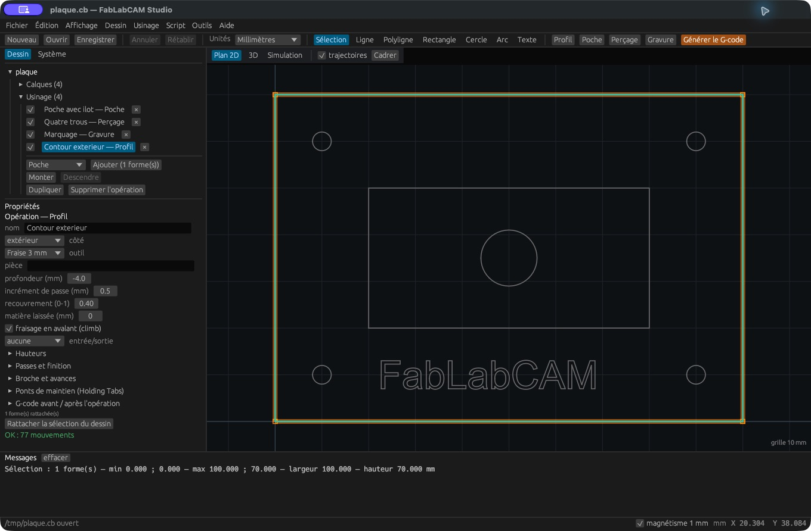
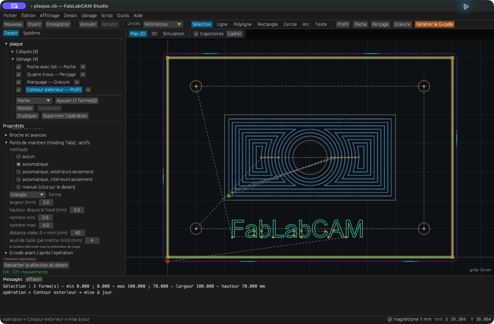

# Profil et ponts de maintien

## Choisir le côté

Sélectionnez un contour puis créez un **Profil**. Le côté indique la position
du centre de l’outil : **extérieur**, **intérieur** ou **sur le trait**. Choisissez
un outil, une profondeur cible et un incrément de passe. Vérifiez le côté du
parcours dans le plan, particulièrement sur les contours imbriqués.

**Matière laissée** conserve une surépaisseur. La surcoupe des coins intérieurs,
les entrées et la finition sont dans les [réglages avancés](parametres.md).

## Conserver la pièce avec des ponts

Ouvrez **Ponts de maintien**. Les méthodes disponibles sont :

| Méthode | Effet |
|---|---|
| Aucun | Parcours sans pont |
| Automatique | Répartition sur les contours admissibles |
| Extérieurs seulement | Répartition limitée aux contours extérieurs |
| Intérieurs seulement | Répartition limitée aux contours intérieurs |
| Manuel | Positions choisies dans le plan |

Réglez la **largeur** et la **hauteur depuis le fond**. La hauteur doit rester
inférieure à la profondeur de coupe. Les formes de pont sont triangle, carré
et interruption (*skip*). Inspectez leur effet en simulation.

En automatique, réglez le nombre minimum/maximum, la distance visée entre
ponts et le seuil de périmètre. Une distance nulle utilise le minimum demandé.
Les petits contours peuvent être exclus par le seuil.

En manuel, choisissez la méthode puis cliquez sur le contour ou sa trajectoire
pour poser un pont ; cliquez un pont pour le retirer. La case **poser / retirer
au clic sur le plan** active ce mode. **Échap** le termine.
**Effacer les ponts** supprime les positions manuelles. Un clic hors du contour
est refusé avec un message.

Les ponts font partie du parcours calculé ; leur résistance dépend du matériau,
de leur placement et de la pièce. Ils ne représentent pas les brides dans la
simulation.
