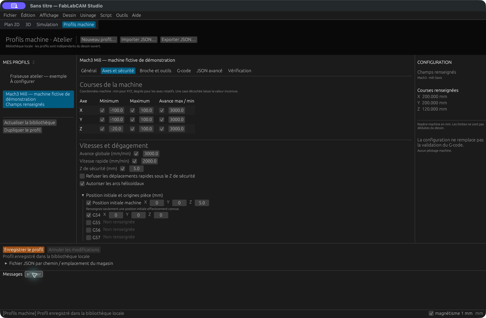
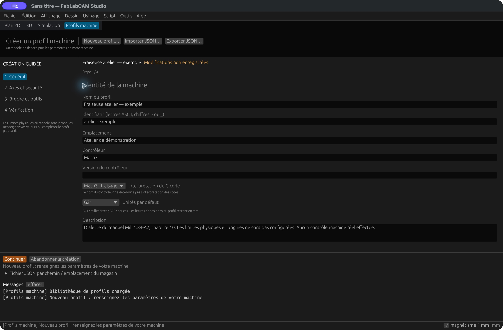
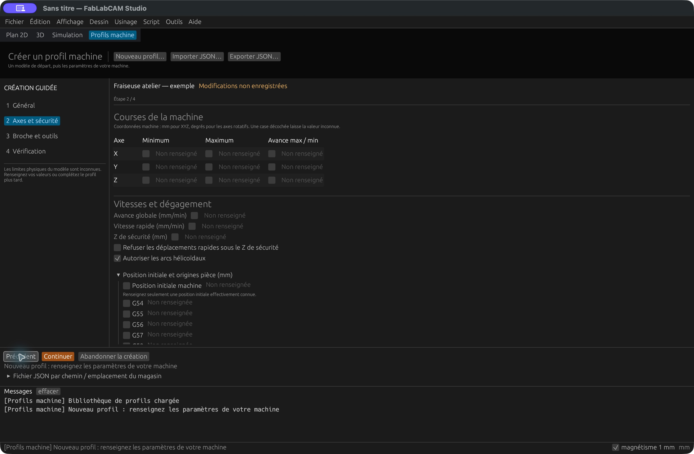
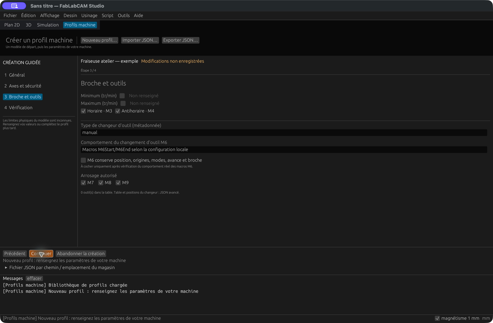
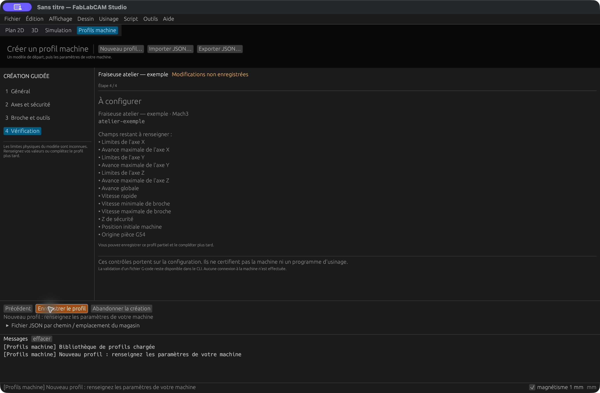
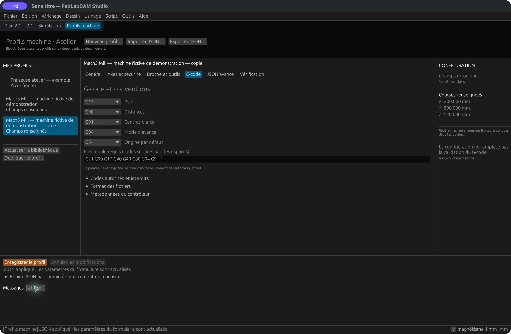
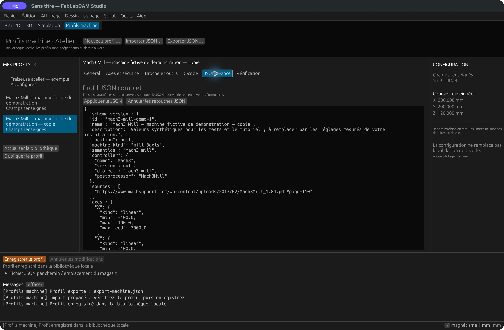
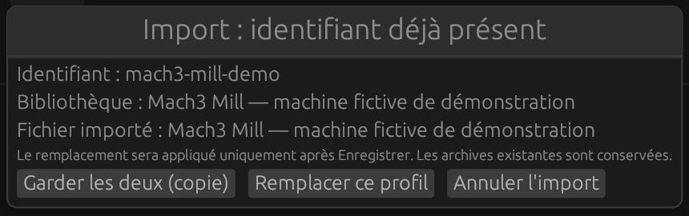
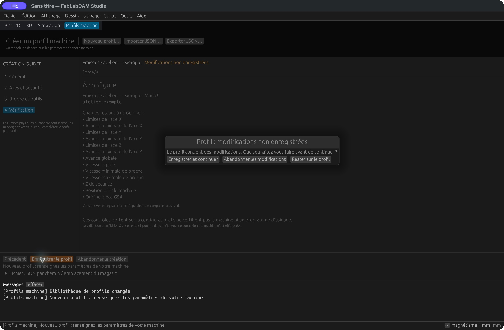

# Profils machine dans le Studio : l’Atelier

Depuis **FabLabCAM 0.4.0**, l’onglet **Profils machine** et le menu
**Outils → Profils machine · Atelier** ouvrent la bibliothèque locale.
Vous pouvez créer, modifier, dupliquer, importer et exporter vos profils sans
quitter le Studio. Cette livraison correspond à l’[issue #11](https://github.com/FabLabCAM/core/issues/11).

[](../assets/screenshots/29-profils-atelier.png)

La bibliothèque est à gauche, les paramètres au centre et le récapitulatif des
courses à droite lorsque la fenêtre est assez large. Les boutons d’enregistrement
et les messages restent en bas. Les formulaires défilent pour accéder aux champs
supplémentaires. Revenez au dessin avec **Plan 2D**, **3D** ou **Simulation** :
le brouillon du profil est conservé en mémoire.

## Créer un profil avec le parcours guidé

Cliquez sur **Nouveau profil…**. L’assistant part de la référence Mach3 Mill,
avec des limites physiques inconnues. Il ne relève aucun paramètre sur une machine.

### 1. Général

Saisissez le nom, l’identifiant, l’emplacement et les informations du contrôleur.
L’identifiant accepte 1 à 80 lettres ASCII, chiffres, tirets ou soulignés. Il devient
immuable après enregistrement ; utilisez **Dupliquer le profil** pour en créer un autre.

Choisissez le modèle d’interprétation du G-code et les unités par défaut.
Le nom du contrôleur ne change pas le sens des codes. **G21** signifie millimètres,
**G20** pouces ; les positions et limites du profil restent en millimètres.

[](../assets/screenshots/24-profil-creation.png)

### 2. Axes et sécurité

Cochez uniquement les valeurs que vous connaissez, puis saisissez les bornes et
avances maximales des axes. Un double-clic dans une valeur numérique permet de la
saisir au clavier. Une case décochée signifie **inconnu**, pas zéro.

Renseignez l’avance globale, la vitesse rapide et le Z de sécurité. Les limites,
le Z de sécurité et la position initiale sont dans le **repère machine**. Dépliez
**Position initiale et origines pièce** pour renseigner G54–G59 : ces coordonnées
décrivent le décalage de l’origine pièce par rapport à l’origine machine.

[](../assets/screenshots/25-profil-axes.png)

Les positions de parc et de changement, la convention des directions et
l’accélération sont des métadonnées ; elles ne déclenchent aucun mouvement.

### 3. Broche et outils

Saisissez les vitesses minimale et maximale, les sens autorisés, le type et le
comportement du changeur, puis l’arrosage. **M6 conserve position, origines, modes,
avance et broche** ne doit être coché qu’après vérification de vos macros M6.
La table détaillée des outils et le nombre de positions du changeur sont éditables
dans **JSON avancé** après la création.

[](../assets/screenshots/26-profil-broche.png)

### 4. Vérification et enregistrement

La dernière étape indique les erreurs, les champs manquants et les avertissements.
Cliquez sur **Enregistrer le profil** pour écrire dans la bibliothèque.
Vous pouvez enregistrer une configuration partielle et la compléter plus tard.

[](../assets/screenshots/27-profil-verification.png)

| État | Signification |
|---|---|
| **À configurer** | Le schéma est accepté, mais des limites ou repères restent inconnus |
| **Champs renseignés** | Les principaux paramètres sont présents ; les avertissements restent à examiner |
| **Erreur de configuration** | Une valeur ou combinaison est refusée par le schéma ; corrigez avant d’enregistrer |

Ces états décrivent la configuration. Ils ne constituent pas une validation
de G-code ou une qualification de machine. La course affichée est `maximum − minimum`.

## Modifier un profil

Sélectionnez-le dans la bibliothèque. Les rubriques **Général**, **Axes et sécurité**,
**Broche et outils**, **G-code**, **JSON avancé** et **Vérification** donnent accès aux
paramètres. **Enregistrer le profil** valide et sauvegarde les modifications.
**Annuler les modifications** propose de les traiter avant de revenir à l’état enregistré.

Dans **G-code**, réglez les modes initiaux, le préambule, les codes autorisés/interdits,
le format et les métadonnées du contrôleur. Séparez les codes par des espaces.
Changer les unités ne réécrit pas le préambule : vérifiez leur cohérence.

[](../assets/screenshots/31-profil-gcode.png)

**JSON avancé** expose le schéma complet, notamment les paramètres qui ne disposent
pas d’un formulaire. Cliquez sur **Appliquer le JSON** pour contrôler la syntaxe et
actualiser les champs, puis sur **Enregistrer le profil**. Un JSON invalide conserve
le profil précédent. Tant que le texte n’est pas appliqué ou annulé, changer de
rubrique, enregistrer et exporter sont refusés. **Annuler les retouches JSON** revient
aux valeurs courantes du formulaire, sans annuler les autres changements du brouillon.

[](../assets/screenshots/30-profil-json.png)

## Importer, exporter et dupliquer

**Importer JSON…** ouvre le sélecteur de fichiers de l’OS. Le fichier doit utiliser
le schéma 1, faire au maximum 1 Mio et ne pas contenir de propriétés inconnues.
L’import prépare un brouillon : examinez-le puis cliquez sur **Enregistrer le profil**.
Vous pouvez essayer avec le [profil fictif de démonstration](../examples/machines/mach3-mill-demo.json).

Si l’identifiant existe déjà, choisissez **Garder les deux (copie)**,
**Remplacer ce profil** ou **Annuler l’import**. La copie reçoit un identifiant distinct.
Le remplacement ne s’applique sur disque qu’après enregistrement ; les instantanés
des archives G-code déjà créées restent inchangés.



**Dupliquer le profil** prépare également une copie à enregistrer.
**Exporter JSON…** écrit les valeurs du brouillon actuellement affiché dans un
nouveau fichier JSON complet. L’export ne sauvegarde pas ce brouillon dans la bibliothèque.
Choisissez un nom disponible : aucun fichier existant n’est remplacé, même après
une confirmation du sélecteur système. L’extension `.json` est ajoutée si nécessaire.

Si les outils de dialogue système sont indisponibles, dépliez **Fichier JSON par
chemin / emplacement du magasin**, saisissez un chemin, puis utilisez **Importer ce
fichier** ou **Exporter vers ce fichier**. L’import par chemin demande d’abord de
sauvegarder ou d’abandonner un brouillon en cours.

## Protéger les modifications

Changer de profil, actualiser la bibliothèque, commencer un autre profil, importer
ou quitter demande de traiter les modifications non enregistrées. Choisissez
**Enregistrer et continuer**, **Abandonner les modifications** ou **Rester sur le profil**.
Un échec d’enregistrement laisse le brouillon ouvert. Sur macOS, la commande native
**Quitter** suit également cette confirmation. Le dessin possède sa propre confirmation.

[](../assets/screenshots/28-profil-modifications.png)

Si une autre instance du Studio ou la CLI a modifié le profil sur disque, la
sauvegarde refuse le conflit. Exportez votre brouillon sous un nouveau nom, puis
abandonnez ses modifications et cliquez sur **Actualiser la bibliothèque** pour
examiner la version courante. Le Studio n’écrase pas silencieusement ce travail.

## Stockage et utilisation avec la CLI

| Système | Magasin par défaut |
|---|---|
| macOS | `~/Library/Application Support/FabLabCAM/machines` |
| Windows | `%LOCALAPPDATA%\FabLabCAM\machines` ; repli sur `%APPDATA%` |
| Linux | `$XDG_DATA_HOME/fablabcam/machines`, sinon `~/.local/share/fablabcam/machines` |

Les fichiers sont sous `profiles/<id>.json`. La variable **`FABLABCAM_MACHINE_STORE`**
permet de choisir un autre magasin avant le lancement. Le panneau par chemin indique
le chemin effectif. Les profils sont indépendants du dessin `.cb` et ne sont pas
inclus dans celui-ci. Sauvegardez le magasin ou exportez les profils pour les transférer.

Pour utiliser ce magasin avec la CLI, passez explicitement son chemin à `--store` :

```sh
fablabcam machine profile list --store "/chemin/du/magasin"
```

Pour analyser un programme avec un profil exporté :

```sh
fablabcam machine validate programme.nc --profile ma-machine.json
```

La [procédure de validation, conversion et archivage](machines.md) décrit les
commandes et les statuts `valid`, `invalid`, `incomplete`. Ces opérations restent
en CLI/API ; l’Atelier ne pilote pas de machine, ne sélectionne pas automatiquement
un `.cbpp` et ne vérifie pas les collisions physiques. La suppression d’un profil
reste une commande CLI.

## Provenance des captures

Captures réelles du **Studio 0.4.0 sur macOS Apple Silicon**, avec un profil créé
pour ce guide et le profil public de machine fictive. Le dialogue de doublon est
recadré pour ne montrer que la décision. Les autres captures montrent la fenêtre
complète. Les sélecteurs système diffèrent selon l’OS ; le parcours illustré
d’import/export a été vérifié par le champ de chemin. Les tests automatiques
couvrent aussi les conflits concurrents et la conservation des archives.
