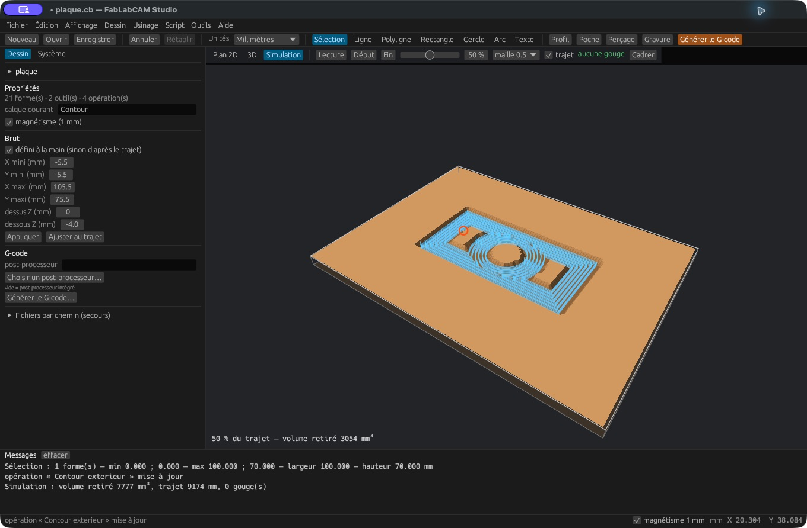
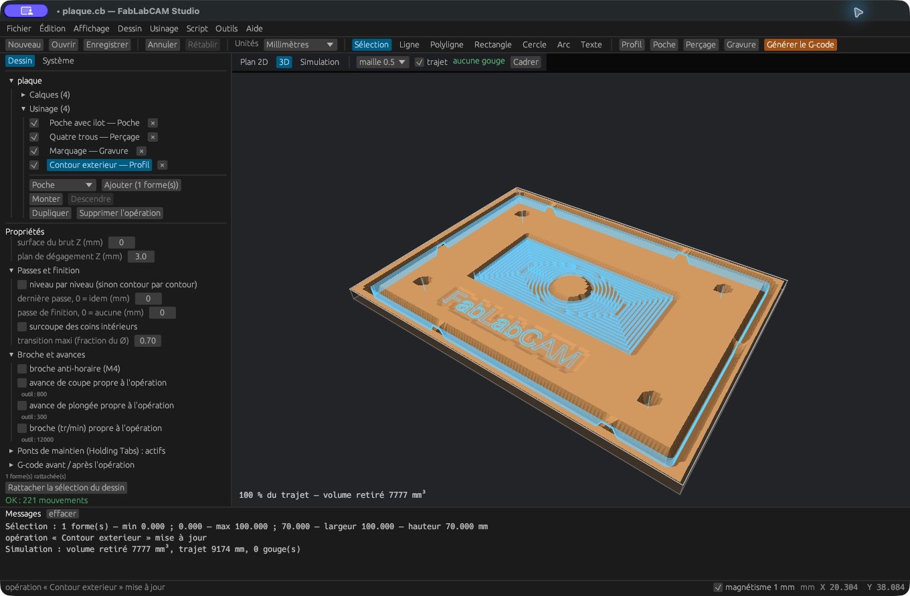
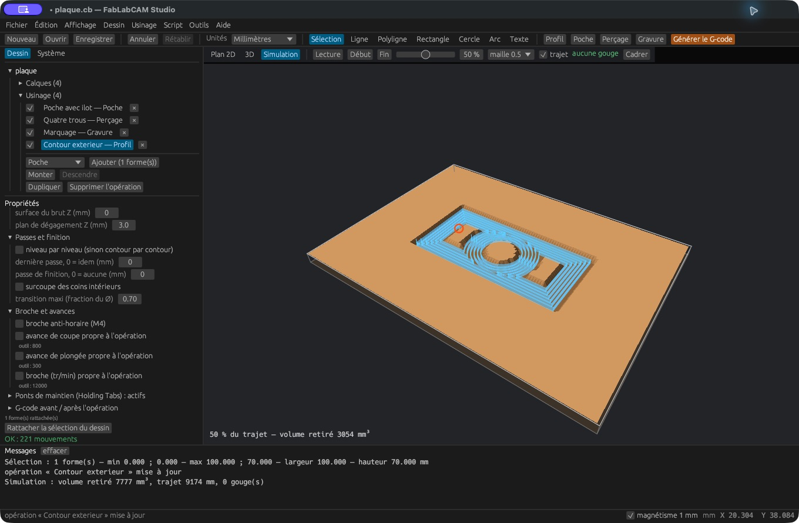

# Brut, vue 3D et simulation

[](../assets/screenshots/18-brut.png)

## Définir le brut

Cliquez le nom du projet. Sans réglage manuel, le brut est estimé d’après les
trajectoires. Cochez **défini à la main** pour renseigner X/Y minimum et maximum,
dessus Z et dessous Z, puis **Appliquer**. **Ajuster au trajet** reprend les
limites estimées à partir des parcours.

Le brut doit représenter la matière réellement disponible. Ses coordonnées
ne déplacent ni le dessin ni l’origine de la machine.

## Vue 3D

[](../assets/screenshots/16-vue-3d.png)

La vue **3D** affiche le résultat d’enlèvement de matière et, si **trajet** est
coché, les mouvements de coupe. Glissez pour tourner la caméra, utilisez la
molette pour zoomer, puis **Cadrer** pour revenir à une vue globale.

## Simulation progressive

[](../assets/screenshots/17-simulation.png)

**Lecture / Pause** anime le parcours. **Début**, **Fin** et le curseur permettent
de choisir une progression. Le pourcentage est basé sur la longueur du trajet,
pas une estimation du temps machine. Le volume retiré est affiché en mm³.

La **maille** peut être 1, 0,5, 0,25, 0,2 ou 0,1 mm. Une maille plus fine augmente
la précision de la grille et le coût du calcul. Comparez un résultat grossier
puis affinez les zones dont la lecture dépend de petits détails.

Le bandeau signale les gouges détectées ; les points correspondants apparaissent
en rouge et des détails sont écrits dans la console. **Aucune gouge** signifie
qu’aucune anomalie de cette catégorie n’a été détectée par ce modèle, pas que
l’usinage est garanti sans collision.

## Portée du modèle

Le simulateur utilise une grille de hauteurs **2.5D**. Il ne représente pas les
contre-dépouilles, les brides, le porte-outil complet, la cinématique, la flexion
ni la matière projetée. Les fraises toriques sont approximées par des fraises
droites. La géométrie rendue est une visualisation, pas un modèle CAO de solide.

La CLI fournit le même type d’inspection sans interface :

```sh
fablabcam sim plaque.cb --res 0.5 --at 1.0
```

`--at 0.5` simule la moitié de la longueur du trajet. La sortie donne les dimensions
de grille, les altitudes, le volume, le temps de calcul et les gouges détectées.
