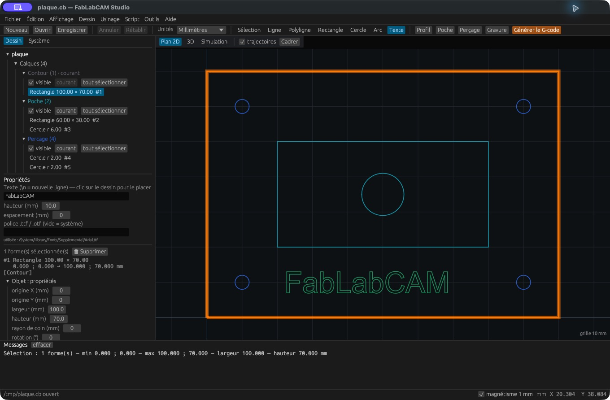

# Texte et polices

1. Choisissez **Texte** ou appuyez sur `T`.
2. Saisissez le texte, sa hauteur et son espacement dans les propriétés.
3. Laissez le chemin de police vide pour utiliser la police système proposée,
   ou indiquez un fichier de police compatible.
4. Cliquez dans le plan pour placer le texte à sa ligne de base.
5. Repassez en Sélection et rattachez les contours à une gravure ou une poche.

Le texte est converti en **contours géométriques**. Il ne reste pas un bloc de
texte éditable : pour changer une phrase, supprimez les contours concernés et
placez un nouveau texte. Les boucles intérieures des lettres sont des formes
séparées ; sélectionnez tous les contours utiles.

La hauteur est calculée à partir de la hauteur des capitales de la police
(avec une mesure du « H » lorsque cette métrique manque). La largeur dépend
de la police et de l’espacement. Les glyphes, les accents et les résultats du
script `text()` peuvent donc varier d’un système à l’autre.

## Résoudre un texte absent

Vérifiez le chemin de police, les messages et la présence du glyphe dans la
police. Sur Linux, installez `fonts-dejavu-core`. Pour échanger une pièce avec
une autre personne, fournissez le projet `.cb` contenant les contours plutôt
que de lui demander de régénérer le texte avec une police différente.

La gravure de ces contours suit les lignes du dessin : ce n’est pas une
reconstruction automatique de police monoligne, ni une gravure en V à largeur
variable.
