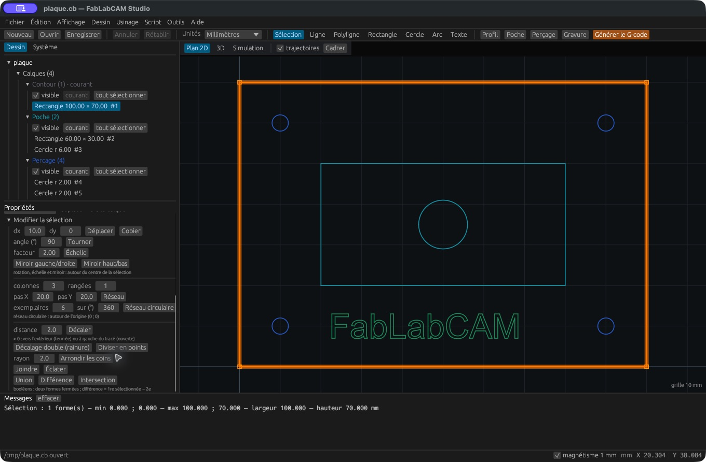

# Transformations, réseaux et booléens

Sélectionnez les formes à modifier puis utilisez **Modifier la sélection**.
Les opérations sont annulables. Vérifiez le résultat dans le plan avant de
recalculer l’usinage.

| Commande | Paramètres et résultat |
|---|---|
| Déplacer | `dx`, `dy` : translation des formes sélectionnées |
| Copier | Même translation appliquée à de nouvelles formes ; originaux conservés |
| Tourner | Angle en degrés autour du centre de la sélection |
| Échelle | Facteur uniforme autour du centre de la sélection |
| Miroir gauche/droite | Symétrie horizontale autour du centre de la sélection |
| Miroir haut/bas | Symétrie verticale autour du centre de la sélection |
| Réseau | Colonnes, rangées, pas X et pas Y |
| Réseau circulaire | Nombre d’exemplaires et angle total ; centre fixé à l’origine (0, 0) |

Pour une couronne de trous autour de l’origine, placez un premier cercle à la
distance souhaitée puis utilisez **Réseau circulaire**. Pour une plaque de trous,
utilisez **Réseau** et vérifiez les pas entre centres.

## Décalages et préparation des contours

**Décaler** crée un contour à la distance saisie. Une distance positive se place
vers l’extérieur d’un contour fermé ou à gauche d’un tracé ouvert.
**Décalage double (rainure)** transforme un tracé ouvert en enveloppe fermée,
avec une distance de chaque côté et des extrémités arrondies.

**Diviser en points** répartit le nombre d’**exemplaires** demandé sur le contour.
Ces points peuvent servir à une opération de perçage. **Arrondir les coins**
applique le rayon saisi aux coins compatibles. Si le rayon est trop grand pour
la géométrie, examinez le message et diminuez-le.

**Joindre** assemble les tracés dont les extrémités sont compatibles.
**Éclater** sépare un tracé en ses éléments. Ces commandes ne réparent pas
arbitrairement un dessin importé : inspectez les petits écarts, doublons et
fermetures avant de créer une poche.

## Union, différence, intersection

Ces commandes attendent **deux formes fermées**. Sélectionnez-les dans l’ordre
voulu, puis :

- **Union** conserve la surface couverte par l’une ou l’autre.
- **Différence** retire la deuxième forme à la première sélectionnée.
- **Intersection** conserve uniquement la surface commune.

Un résultat peut contenir plusieurs contours. Vérifiez les îlots et le
rattachement des opérations lorsque vous remplacez une géométrie existante.
