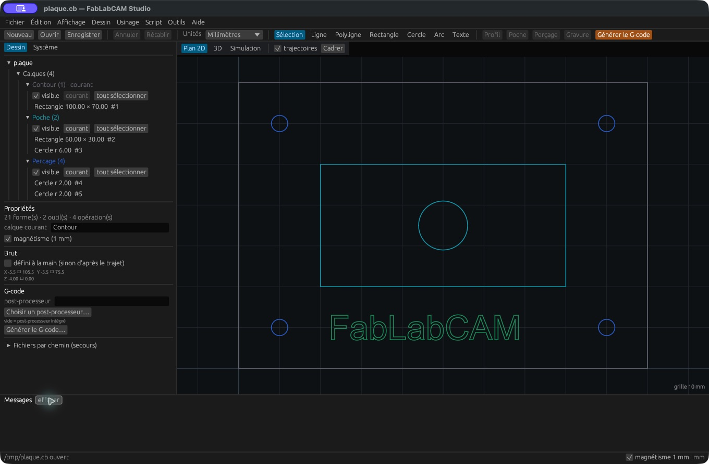

# FabLabCAM — du dessin au parcours d’outil

**FabLabCAM 0.8.0** est un atelier de CAO/FAO 2.5D, libre sous licence
Apache-2.0. Dessinez une pièce, définissez vos outils, préparez les opérations,
inspectez le résultat et exportez le G-code. Le module **Meubles** prépare aussi
des caissons et étagères paramétriques avec leurs plans de découpe.

[Installer FabLabCAM](installation.md){ .md-button .md-button--primary }
[Créer votre première plaque](guide/premier-projet.md){ .md-button }

## Trois façons de travailler

| Composant | Usage |
|---|---|
| **Studio** | Interface graphique : dessin, outils, usinage, brut, simulation, profils machine et meubles |
| **CLI `fablabcam`** | Génération, scripts, simulation, profils de machine, validation, archives G-code et dossiers de meubles |
| **Viewer `fablabcam-view`** | Inspection interactive d’un G-code existant |

Le projet natif utilise l’extension **`.cb`**. Les échanges de dessin utilisent
DXF et SVG. Les quatre opérations disponibles sont **profil, poche, perçage et
gravure**. La vue 3D représente la matière calculée par la simulation ; ce
n’est pas un modeleur de solides ni une FAO multiaxe.

[Fabriquer un meuble pour le FabLab](guide/meubles.md){ .md-button }

[Utiliser l’assistant Ask, Plan et Agent](guide/assistant.md){ .md-button }

## Un parcours guidé

1. [Installer](installation.md) la version adaptée à votre ordinateur.
2. [Ouvrir la plaque d’exemple](guide/premier-projet.md).
3. [Découvrir le dessin](guide/dessin.md) et [la table d’outils](guide/outils.md).
4. [Configurer l’usinage](guide/operations.md), puis [simuler](guide/simulation.md).
5. [Exporter et contrôler le G-code](guide/gcode.md).

L’[index des fonctionnalités](reference/fonctionnalites.md) relie chaque famille
fonctionnelle à sa procédure et à une capture. Les captures du dessin proviennent de la version 0.2.0 ; celles de l’Atelier
proviennent des versions 0.4.0 et 0.4.1 ; celles du module Meubles des versions 0.5.0 et 0.6.0.
La capture du contrôle des identifiants Rhai provient du paquet installé 0.6.1.
Les captures de l’assistant proviennent de la compilation de validation 0.7.0.
Elles sont prises sur macOS Apple Silicon
avec des exemples publics créés pour ce guide. Les dialogues système et polices peuvent varier selon l’OS.

!!! info "Nouveau en v0.8.0"
    [Copiez et réutilisez les messages](guide/assistant.md#copier-et-reutiliser-un-message)
    de l’Assistant : message complet, extrait sélectionné ou ajout au prompt sans perdre le brouillon.

!!! info "Correctif v0.7.3"
    [Compatibilité de l’assistant](guide/assistant.md#compatibilite-des-fournisseurs-en-073) :
    GPT-4.1 mini corrigé, essais OpenAI/Claude réussis et configuration Ollama documentée.
    Les petits modèles Ollama restent partiellement qualifiés.

!!! info "Correctif v0.7.1"
    L’[import SVG](guide/fichiers.md#import-svg-corrige-en-071) conserve les transformations
    imbriquées, exclut les définitions et lit les nombres scientifiques.

!!! info "Nouveau en v0.7.0"
    Un [assistant natif](guide/assistant.md) accompagne chaque page : Ask pour
    comprendre, Plan pour préparer et Agent pour appliquer chaque lot validé.
    Mistral testé réellement ; qualification des autres services encore suivie.

!!! info "Correctif v0.6.1"
    Les [scripts Rhai](reference/rhai.md#identifiants-des-formes) refusent désormais
    les identifiants négatifs ou trop grands, seuls ou dans un tableau. Une valeur
    erronée ne peut plus sélectionner une autre forme par troncature.

!!! info "Depuis la v0.6.0"
    [Composez vos meubles](guide/composer-meubles.md) : tablettes, séparations,
    grilles, bacs et huit familles d'assemblages. Enregistrez toute la structure
    comme modèle, partagez les fichiers natifs et préparez les dalles CNC.

Les essais après 0.7.0 et les limites des modèles sont suivis dans le
[correctif de compatibilité de l’assistant](guide/assistant.md#compatibilite-des-fournisseurs-en-073),
inclus dans la version 0.7.3, avec les limites Ollama indiquées.

## Corriger et diagnostiquer les profils DXF

La version 0.7.2 protège le calcul des profils et couvre le crash sur les lettres avec sommets répétés.
Les [préférences de diagnostic](reference/diagnostics.md) donnent accès aux journaux,
aux piles complètes et à l'export des rapports. Elle reprend aussi les corrections
[Mach3](guide/gcode.md#mach3-fichier-charge-lancement-bloque) de la préversion.

Le correctif ciblé de [division Ollama](guide/assistant.md#division-ollama-correctif-en-preparation)
est en préparation dans l’issue #20 ; les installateurs publiés restent en 0.8.0.
