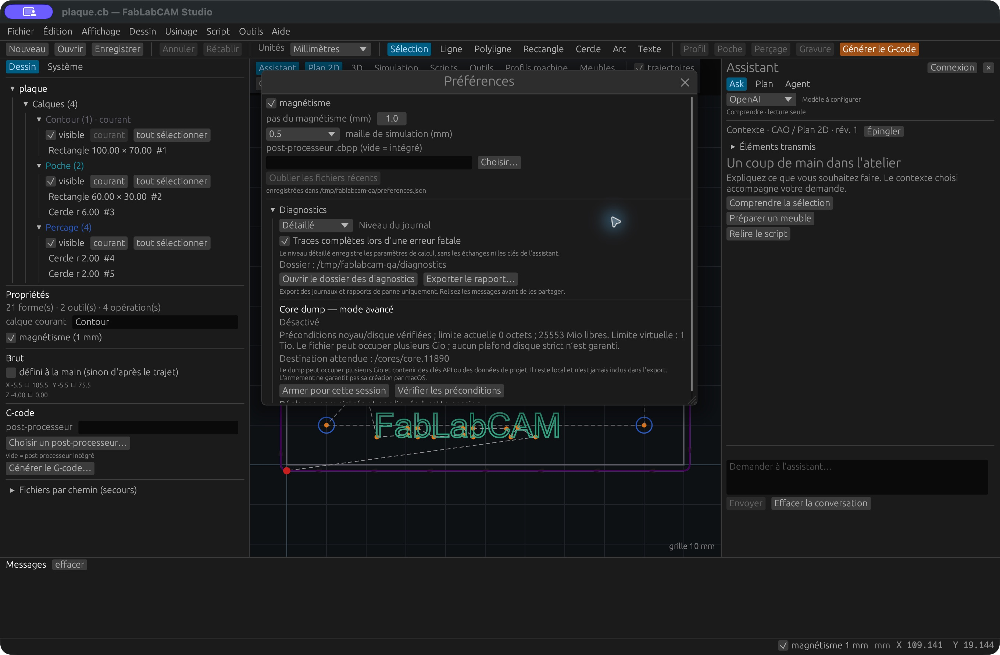

# Journaux et rapports de panne

Disponible depuis [FabLabCAM 0.7.1](https://github.com/FabLabCAM/core/releases/tag/v0.7.1),
avec le correctif de l'[issue #24](https://github.com/FabLabCAM/core/issues/24).

## Activer les diagnostics dans l’interface

1. Ouvrez **Outils → Préférences → Diagnostics**.
2. Sélectionnez **Détaillé** dans **Niveau du journal** pour enregistrer les
   calculs : opération, formes, nombre de sommets, côté, diamètre, décalage et durée.
3. Gardez **Traces complètes lors d’une erreur fatale** cochée pour enregistrer
   la pile d’une panique Rust, y compris après un lancement depuis Finder.
4. Reproduisez le problème, puis utilisez **Ouvrir le dossier des diagnostics**
   ou **Exporter le rapport…**. Après un crash, relancez d’abord le Studio.

Ces deux réglages sont appliqués immédiatement et mémorisés. Le niveau Normal
conserve les événements de session et les erreurs de calcul. Le journal détaillé
n’enregistre pas les échanges réseau ni les clés de l’assistant.

[](../assets/screenshots/54-diagnostics.png)

Capture réelle du binaire de développement 0.7.1, macOS Apple Silicon, avec
[plaque.rhai](../examples/plaque.rhai) et stockage de test isolé. Le bundle de
cette capture est signé pour diagnostic ; le mode core reste désactivé.

## Retrouver les fichiers

| Système | Dossier par défaut |
|---|---|
| macOS | `~/Library/Logs/FabLabCAM` |
| Windows | `%LOCALAPPDATA%\FabLabCAM\Diagnostics` |
| Linux | `$XDG_STATE_HOME/fablabcam/diagnostics`, sinon `~/.local/state/fablabcam/diagnostics` |

Les fichiers `session-*.jsonl` contiennent les événements horodatés, version,
identifiant de build et PID. Les fichiers `panic-*.txt` conservent séparément
chaque panique : une seconde erreur ne remplace pas la première. Une compilation
locale sans identifiant explicite indique `local`.

Le journal dispose de huit emplacements pour plusieurs instances. Chacun garde
un fichier de 1 Mio et trois rotations, soit au plus 32 Mio de journaux. Au
lancement, les vingt derniers rapports de panique sont conservés. Un dossier
inaccessible produit un message visible ; le terminal reste un repli pour les
pannes d’écriture.

L’export rassemble les journaux et rapports texte, **sans projet, préférences ni
core dump**. Relisez-le avant de le joindre à une issue : un message de panique
ou une pile peut contenir un chemin privé. L’export n’envoie rien sur Internet.

## Core dump sur macOS

Un core contient la mémoire du processus, peut occuper plusieurs Gio et inclure
des données de projet ou des clés API. Il reste local et ne fait jamais partie
de l’export texte. Sa collecte est utile quand une pile seule ne suffit pas.

Le bouton **Armer pour cette session** est disponible seulement si les
préconditions sont satisfaites : binaire signé pour diagnostic, capture autorisée
par macOS, dossier accessible, limite système suffisante et au moins 10 Gio libres.
L’interface affiche le motif d’un refus et le chemin attendu, habituellement
`/cores/core.<PID>`. **Vérifier les préconditions** actualise cet état.

L’armement ne persiste pas après relance. **Désarmer** restaure la limite souple
initiale du processus. Si une panique survient pendant l’armement, le Studio écrit
son rapport puis s’arrête volontairement pour demander le core — même si cette
panique aurait pu être récupérée pendant un calcul. macOS peut encore refuser
la capture ; un état « armé » ne prouve pas qu’un fichier a été créé.

La limite noyau porte sur la mémoire virtuelle : elle vaut 1 Tio pour couvrir les
réservations de macOS. **Ce n’est pas un plafond d’occupation disque**. Les paquets
normaux n’activent pas l’autorisation de débogage `get-task-allow` ; leur interface
indique qu’une compilation de diagnostic est nécessaire. Aucun réglage global
macOS ni permission de dossier n’est changé par le Studio.

### Préparer une compilation de diagnostic

Dans les sources correspondant au correctif, avec Python 3.12, Rust et les outils
Xcode installés :

```sh
python3.12 packaging/diagnostic_macos.py
open "target/diagnostic-app/FabLabCAM Diagnostic.app"
```

Le script produit un bundle distinct, optimisé, signé pour diagnostic et accompagné
par `fablabcam-studio-ui.dSYM`. Il ne remplace pas l’application installée. Conservez
ensemble ce binaire exact et son dSYM. Après une capture :

```sh
dwarfdump --uuid "target/diagnostic-app/FabLabCAM Diagnostic.app/Contents/MacOS/fablabcam-studio-ui"
dwarfdump --uuid target/diagnostic-app/fablabcam-studio-ui.dSYM
lldb --core /cores/core.PID
# Dans LLDB :
# target symbols add target/diagnostic-app/fablabcam-studio-ui.dSYM
# thread backtrace all
```

Les UUID doivent correspondre. Une reconstruction ultérieure de la même version
ne suffit pas à garantir la correspondance des symboles. Pour une panne native
sans panique Rust, consultez aussi les rapports macOS dans Console.

## Équivalents en ligne de commande

```sh
fablabcam-studio-ui dessin.dxf --diagnostics --backtrace full
fablabcam-studio-ui --tab diagnostics --log-level debug
fablabcam-studio-ui --diagnostics-dir /tmp/fablabcam-diagnostic
```

`--log-level normal|debug`, `--backtrace off|full` et `--diagnostics` remplacent les
réglages pour cette session seulement. `--core-on-panic` demande l’armement sous
les mêmes préconditions que l’interface. `FABLABCAM_DIAGNOSTICS_DIR` permet aussi
d’isoler le stockage. Ces options appartiennent au **Studio graphique**.

## Profil de lettres DXF

Le correctif #24 retire, sur une copie utilisée pour l’offset, les positions
répétées et sommets redondants. Le dessin original reste inchangé. Le cas signalé
était une lettre E fermée dont le dernier sommet répétait le premier.

Une erreur de calcul est affichée et le projet reste éditable. Un ancien parcours
peut rester visible pour comparaison ; l’export du projet est bloqué tant qu’une
opération active est en erreur. Corrigez ou désactivez cette opération avant
l’export. Les paniques récupérables ne couvrent pas l’épuisement mémoire, SIGKILL,
les blocages ni toutes les erreurs natives.
