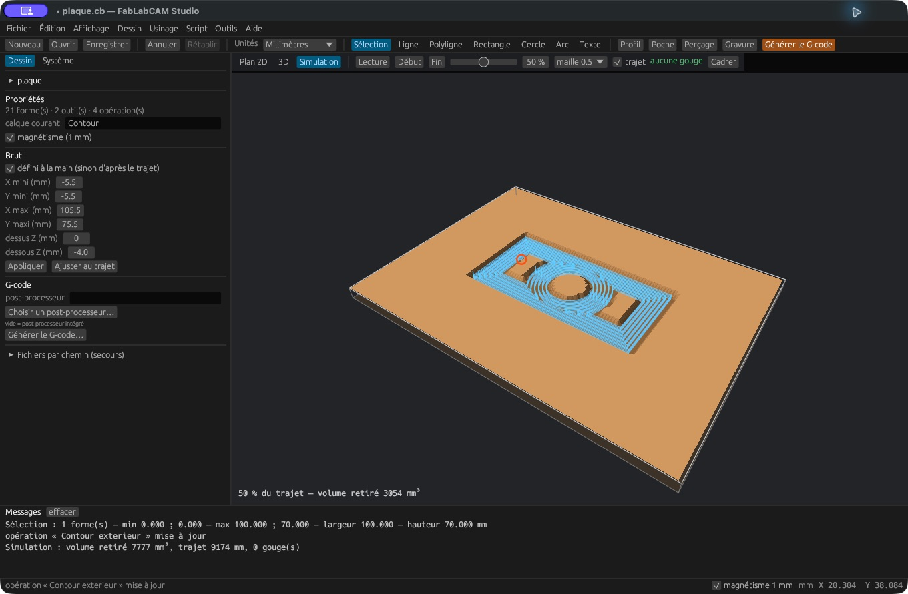

# Post-processeurs `.cbpp`

Le post-processeur transforme les trajectoires en dialecte G-code. Dans le
Studio, indiquez un fichier `.cbpp` dans **Système → Post-processeur** ou dans
les propriétés du projet. Un chemin vide utilise les gabarits intégrés.

[](../assets/screenshots/18-brut.png)

## Structure et personnalisation

Le fichier est un XML dont la racine est `<PostProcessor>`. Les propriétés
absentes conservent leur valeur par défaut. Exemple minimal qui change la
précision et ajoute des numéros de ligne :

```xml
<PostProcessor>
  <NumberFormat>0.0###</NumberFormat>
  <AddLineNumbers>true</AddLineNumbers>
  <LineNumberStart>10</LineNumberStart>
  <LineNumberIncrement>10</LineNumberIncrement>
  <LineNumberPrefix>N</LineNumberPrefix>
</PostProcessor>
```

Téléchargez [cet exemple](../examples/exemple.cbpp). Il démontre la syntaxe ;
il ne représente pas un profil validé pour un contrôleur particulier.

```sh
fablabcam build plaque.cb --post exemple.cbpp -o plaque-numerotee.nc
```

## Propriétés reconnues

| Famille | Éléments XML |
|---|---|
| Structure du programme | `PostFile`, `Header`, `Footer`, `MOP`, `ToolChange`, `ToolTableItem` |
| Mouvements | `Rapid`, `FeedMove`, `ArcCW`, `ArcCCW`, `Drill`, `DrillDwell`, `DrillPeck` |
| Texte et nombres | `Comment`, `EndComment`, `EndOfLine`, `NumberFormat` |
| Arcs | `MinimumArcLength`, `MaximumArcRadius`, `ArcCenterMode`, `ArcOutput`, `ArcToLinesTolerance` |
| Numérotation | `AddLineNumbers`, `LineNumberStart`, `LineNumberIncrement`, `LineNumberPrefix`, `LineNumberFormat`, `LineNumberSkip`, `LineNumberSpaceAfter` |
| Modalités | `UnitsInches`, `UnitsMetric`, `DistanceAbsolute`, `WorkplaneXY`, `ArcCenterIncremental`, `ArcCenterAbsolute` |
| Broche et fin | `SpindleCW`, `SpindleCCW`, `SpindleOff`, `EndRewind` |
| Compensation | `CutterCompOff`, `CutterCompLeft`, `CutterCompRight` |
| Codes de mouvement | `G0`, `G1`, `G2`, `G3`, `G81`, `G82`, `G83` |
| Macros utilisateur | `PostProcessorMacros` |

`NumberFormat` utilise `0` pour un chiffre obligatoire et `#` pour un chiffre
facultatif. `EndOfLine` reconnaît les séquences `\r` et `\n`.
`ArcCenterMode` accepte notamment `absolute`, le mode incrémental usuel et
`incrementalp1c`. `ArcOutput` accepte `Normal`, `ConvertToLines` et
`HelixConvertToLines`. La tolérance contrôle la segmentation des arcs.

## Macros

Les gabarits utilisent `{$nom}`. Les principales macros de structure sont
`{$header}`, `{$footer}`, `{$mops}`, `{$blocks}`, `{$toolchange}` et `{$tooltable}`.
Les propriétés de contexte comprennent `{$cbfile.name}`, `{$date}`,
`{$mop.name}`, `{$mop.header}`, `{$mop.footer}`, `{$tool.index}`,
`{$tool.name}`, `{$tool.comment}`, `{$tool.diameter}` et `{$tool.radius}`.
Les mots de mouvement sont développés à partir de l’état du parcours.

Une macro personnalisée s’écrit `$nom=valeur`, une par ligne dans
`PostProcessorMacros`. La CLI peut en ajouter avec `--macros` :

```sh
fablabcam build plaque.cb --post machine.cbpp --macros '$atelier=FabLabCAM' -o plaque.nc
```

Le champ **Changement d’outil** d’un outil remplace son gabarit par défaut.
Les en-têtes et pieds d’opération sont également accessibles au post-traitement.
Pour une référence exacte des macros de mouvement et de leurs conditions,
consultez [le moteur de la version 0.2.0](https://github.com/FabLabCAM/core/blob/v0.2.0/crates/fablabcam-cam/src/post.rs).

## Compatibilité et vérification

Les éléments XML non pris en charge sont signalés par le parseur ;
`ClearancePlaneAxis` et `InvertArcs` sont lus mais sans effet. Cette version ne
fournit pas de tournage ni de gestion générale des cycles G98/G80. Les fichiers
complexes ne doivent pas être considérés comme interchangeables sans vérification.

Le Studio peut refuser un export lorsqu’un avertissement de rendu apparaît.
Lisez la sortie de la CLI et comparez le programme exporté avec les attentes de
votre contrôleur. Testez les changements d’outil, les unités, les arcs, les cycles
et les changements de niveau avant de réutiliser un nouveau post-processeur.
