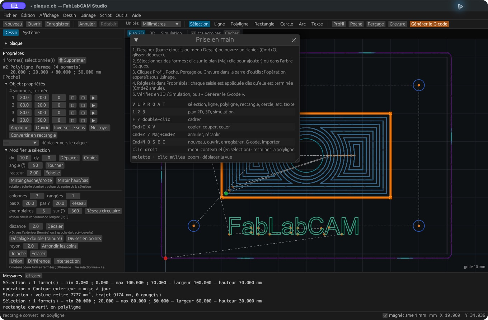
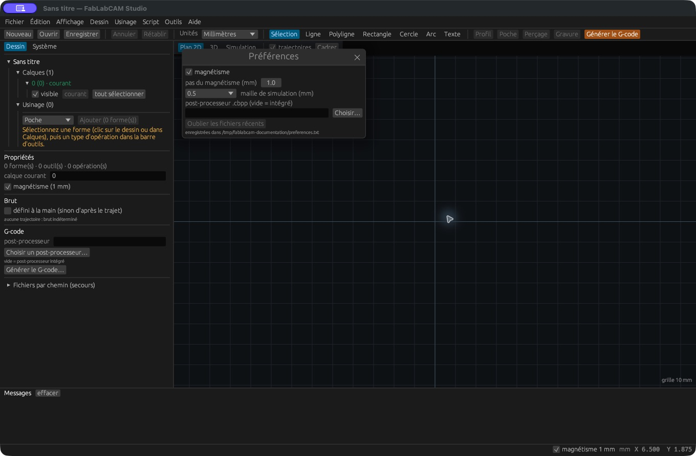

# Raccourcis, préférences et aide

## Clavier

Dans ce tableau, **Mod** signifie `Cmd` sur macOS et `Ctrl` sur Windows/Linux.
Les libellés de menus peuvent afficher `Cmd` sur plusieurs plateformes.
Les raccourcis de dessin sont utilisés hors saisie dans un champ texte.

| Touche | Action |
|---|---|
| `Mod+N` / `Mod+O` | Nouveau / ouvrir |
| `Mod+S` / `Mod+Maj+S` | Enregistrer / enregistrer sous |
| `Mod+I` / `Mod+E` | Importer un dessin / exporter le G-code |
| `Mod+,` | Préférences |
| `Mod+Z` / `Mod+Maj+Z` | Annuler / rétablir |
| `Mod+A` | Tout sélectionner |
| `Mod+C`, `Mod+X`, `Mod+V` | Copier, couper, coller les formes |
| `Suppr` ou retour arrière | Supprimer la sélection |
| `V`, `L`, `P`, `R`, `O`, `A`, `T` | Sélection, ligne, polyligne, rectangle, cercle, arc, texte |
| `Entrée` pendant une polyligne | Terminer ouverte |
| `C` pendant une polyligne | Terminer fermée |
| `Échap` | Abandonner le tracé en cours, vider la sélection, terminer le mode ponts |
| `1`, `2`, `3` | Plan 2D, 3D, simulation |
| `F` ou double-clic | Cadrer |
| `Maj` + clic | Ajouter/retirer une forme à la sélection |
| Clic droit | Menu contextuel ; terminer la polyligne en mode dessin |

## Raccourcis dans l’Atelier des profils

Quand l’onglet **Profils machine** est actif, `Mod+N` crée un profil, `Mod+O`
ou `Mod+I` importe un JSON, `Mod+S` enregistre le profil et `Mod+E` l’exporte.
Les raccourcis de dessin sont suspendus dans cet espace. Les menus de fichiers
conservent leurs opérations sur le dessin. [Voir le parcours complet](../guide/profils-studio.md).

## Préférences

Ouvrez **Outils → Préférences** pour régler le magnétisme, son pas, la maille de
simulation et le post-processeur par défaut. **Oublier les fichiers récents**
efface la liste d’historique d’ouverture ; cela ne supprime pas les fichiers.

| Système | Fichier de préférences |
|---|---|
| macOS | `~/Library/Application Support/FabLabCAM/preferences.txt` |
| Windows | `%APPDATA%\FabLabCAM\preferences.txt` |
| Linux | `$XDG_CONFIG_HOME/fablabcam/preferences.txt`, sinon `~/.config/fablabcam/preferences.txt` |

La bibliothèque `outils.cb` se trouve dans le même dossier. La variable
`FABLABCAM_PREFS` permet de choisir un fichier différent, par exemple pour un
profil de test. Sauvegardez ces fichiers si vous voulez transférer les réglages
et la bibliothèque vers une autre installation.

## Console et aide

Le menu **Affichage** contrôle les trajectoires et la console. La zone
**Messages** indique les actions, dimensions, erreurs et bilans de simulation.
**effacer** vide l’affichage du journal. **Aide → Raccourcis et prise en main**
ouvre le résumé intégré. Pour un problème reproductible, conservez le message
exact, la version, l’OS et un petit fichier d’exemple partageable.
