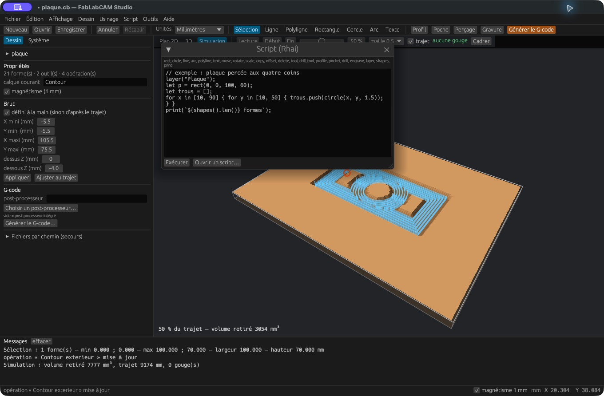

# Automatiser avec Rhai

[](../assets/screenshots/19-script.png)

Ouvrez **Script → Éditeur de script**, saisissez votre programme puis **Exécuter**.
**Ouvrir un script** charge un fichier `.rhai`. Les sorties de `print` sont
écrites dans le journal. L’exécution travaille sur une copie du projet : une
 erreur annule les changements du script. Une exécution réussie est une
modification du projet que vous devez ensuite enregistrer.

## Premier exemple

```rust
layer("Plaque");
let contour = rect(0, 0, 100, 70);
let trous = [];
for x in [10, 90] {
    for y in [10, 60] {
        trous.push(circle(x, y, 2));
    }
}
tool("Fraise 3 mm", 3);
drill_tool("Foret 4 mm", 4);
drill("Trous", trous, "Foret 4 mm", -4);
profile("Contour", contour, "Fraise 3 mm", -4);
print(`Projet : ${shapes().len()} formes`);
```

Les nombres acceptent entiers et décimaux. Les angles sont en degrés, les
longueurs de l’API en millimètres. `ids` accepte un identifiant ou un tableau.
Le nom d’un outil doit exister avant de créer une opération qui l’utilise.
Exécuter deux fois un script ajoute à nouveau ses objets : commencez sur un
projet vide pour reproduire un exemple de création.

## Référence complète de l’API exposée

| Fonction | Effet / résultat |
|---|---|
| `layer(nom)` | Choisit le calque pour les créations suivantes |
| `line(x0, y0, x1, y1)` | Crée une ligne, retourne son identifiant |
| `rect(x0, y0, x1, y1)` | Crée un rectangle entre deux coins, retourne son identifiant |
| `circle(cx, cy, rayon)` | Crée un cercle, retourne son identifiant |
| `arc(cx, cy, rayon, debut, balayage)` | Crée un arc ; angles en degrés, sens trigonométrique |
| `polyline([[x,y], ...], fermee)` | Crée une polyligne ; `fermee` vaut `true` ou `false` |
| `text(texte, x, y, hauteur)` | Vectorise avec la police système, retourne un tableau d’identifiants |
| `shapes()` | Retourne les identifiants de toutes les formes |
| `move(ids, dx, dy)` | Déplace les formes |
| `rotate(ids, cx, cy, angle)` | Tourne autour du centre indiqué |
| `scale(ids, cx, cy, facteur)` | Met à l’échelle autour du centre indiqué |
| `copy(ids, dx, dy)` | Copie et retourne les nouveaux identifiants |
| `offset(ids, distance)` | Crée des contours décalés et retourne leurs identifiants |
| `delete(ids)` | Supprime les formes indiquées |
| `tool(nom, diametre)` | Ajoute une fraise droite |
| `drill_tool(nom, diametre)` | Ajoute un foret |
| `profile(nom, ids, outil, profondeur)` | Ajoute un profil, retourne l’identifiant de l’opération |
| `pocket(nom, ids, outil, profondeur)` | Ajoute une poche |
| `drill(nom, ids, outil, profondeur)` | Ajoute un perçage |
| `engrave(nom, ids, outil, profondeur)` | Ajoute une gravure |
| `print(valeur)` | Écrit un message |

L’API n’expose pas toutes les propriétés du Studio. Ajustez les paramètres
complémentaires dans l’interface après génération, ou utilisez les options CLI
appropriées pour une génération directe.

## Exécution sans interface

```sh
fablabcam script plaque.rhai -o plaque.cb
fablabcam script modifications.rhai projet.cb -o projet-modifie.cb
```

Le projet d’entrée est optionnel. Le [script complet de la plaque](../examples/plaque.rhai)
sert de base reproductible au tutoriel. La génération de texte dépend de la police
installée ; le `.cb` fourni conserve les contours utilisés pour les captures.

L’interpréteur limite une exécution à cinq millions d’opérations élémentaires
et une profondeur d’expression de 64. Ces limites arrêtent notamment une boucle
infinie ; elles ne sont pas un quota d’opérations d’usinage. L’API de projet ne
fournit pas de fonction de commande machine ou de téléchargement réseau.
