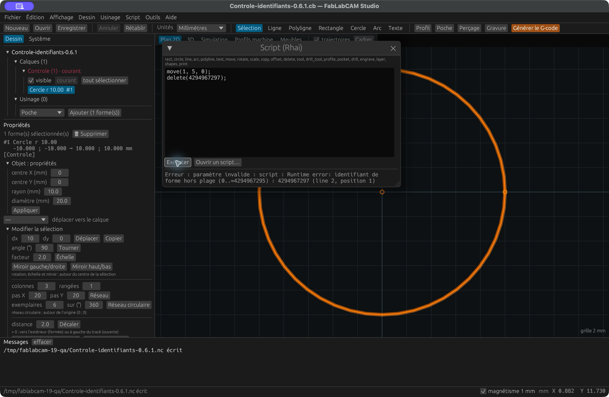

# Automatiser avec Rhai

[](../assets/screenshots/19-script.png)

Ouvrez **Script → Éditeur de script**, saisissez votre programme puis **Exécuter**.
**Ouvrir un script** charge un fichier `.rhai`. Les sorties de `print` sont
écrites dans le journal. L’exécution travaille sur une copie du projet : une
erreur annule les changements du script. Une exécution réussie est une
modification du projet que vous devez ensuite enregistrer. **Annuler** restaure
le projet en une seule étape. Le script prérempli dessine une plaque et quatre
trous sans créer d’opérations d’usinage ; utilisez les fonctions `tool`, `profile`,
`pocket`, `drill` ou `engrave` pour en ajouter, comme dans les exemples ci-dessous.

## Premier exemple

```rust
layer("Plaque");
let contour = rect(0, 0, 100, 70);
let trous = [];
for x in [10, 90] {
    for y in [10, 60] {
        trous.push(circle(x, y, 2));
    }
}
tool("Fraise 3 mm", 3);
drill_tool("Foret 4 mm", 4);
drill("Trous", trous, "Foret 4 mm", -4);
profile("Contour", contour, "Fraise 3 mm", -4);
print(`Projet : ${shapes().len()} formes`);
```

Les nombres acceptent entiers et décimaux. Les angles sont en degrés, les
longueurs de l’API en millimètres. `ids` accepte un identifiant ou un tableau.
Le nom d’un outil doit exister avant de créer une opération qui l’utilise.
Exécuter deux fois un script ajoute à nouveau ses objets : commencez sur un
projet vide pour reproduire un exemple de création.

## Identifiants des formes

Depuis **0.6.1**, les références doivent être des entiers compris dans la plage
numérique **0 à 4 294 967 295** et désigner une forme existante. Utilisez de
préférence les identifiants renvoyés par les fonctions de création ou `shapes()`.
Un nombre décimal comme `1.0`, une chaîne et un booléen ne sont pas acceptés.
La plage numérique seule ne garantit pas l’existence de la forme.

La même vérification s’applique à chaque élément d’un tableau. Une valeur négative
ou trop grande est refusée avant utilisation, sans conversion modulo : par exemple
`4294967297` ne désigne plus la forme `1`. Le diagnostic conserve la valeur fautive
et la ligne du script. Cela concerne transformations, copies, offset, suppression
et références des opérations d’usinage.

Téléchargez le [script de vérification](../examples/scripts/identifiant-invalide.rhai)
et exécutez-le avec **0.6.1 ou plus récent** dans un dossier de test :

```sh
fablabcam script identifiant-invalide.rhai -o sortie.cb
```

Résultat attendu : échec avec `identifiant de forme hors plage (0..=4294967295) : 4294967297`.
Aucun fichier `sortie.cb` n’est créé ; une sortie préexistante reste inchangée.
Dans le Studio, le dessin et l’historique Annuler/Rétablir restent inchangés même
si des instructions valides précèdent l’erreur. Corrigez la référence et relancez.

La version 0.6.0 et les versions antérieures pouvaient tronquer ces valeurs et
modifier une autre forme. Ce correctif est décrit dans l’[issue #19](https://github.com/FabLabCAM/core/issues/19).

[](../assets/screenshots/48-script-identifiants.png)

Capture du **Studio 0.6.1 installé depuis le DMG macOS ARM64** : le cercle `#1`
reste à X = 0 malgré le `move` précédant l’erreur ligne 2. Le refus d’un tableau
contenant une valeur négative, l’exécution d’un déplacement valide et son
annulation en une étape ont aussi été vérifiés dans ce paquet.

## Référence complète de l’API exposée

| Fonction | Effet / résultat |
|---|---|
| `layer(nom)` | Choisit le calque pour les créations suivantes |
| `line(x0, y0, x1, y1)` | Crée une ligne, retourne son identifiant |
| `rect(x0, y0, x1, y1)` | Crée un rectangle entre deux coins, retourne son identifiant |
| `circle(cx, cy, rayon)` | Crée un cercle, retourne son identifiant |
| `arc(cx, cy, rayon, debut, balayage)` | Crée un arc ; angles en degrés, sens trigonométrique |
| `polyline([[x,y], ...], fermee)` | Crée une polyligne ; `fermee` vaut `true` ou `false` |
| `text(texte, x, y, hauteur)` | Vectorise avec la police système, retourne un tableau d’identifiants |
| `shapes()` | Retourne les identifiants de toutes les formes |
| `move(ids, dx, dy)` | Déplace les formes |
| `rotate(ids, cx, cy, angle)` | Tourne autour du centre indiqué |
| `scale(ids, cx, cy, facteur)` | Met à l’échelle autour du centre indiqué |
| `copy(ids, dx, dy)` | Copie et retourne les nouveaux identifiants |
| `offset(ids, distance)` | Crée des contours décalés et retourne leurs identifiants |
| `delete(ids)` | Supprime les formes indiquées |
| `tool(nom, diametre)` | Ajoute une fraise droite |
| `drill_tool(nom, diametre)` | Ajoute un foret |
| `profile(nom, ids, outil, profondeur)` | Ajoute un profil, retourne l’identifiant de l’opération |
| `pocket(nom, ids, outil, profondeur)` | Ajoute une poche |
| `drill(nom, ids, outil, profondeur)` | Ajoute un perçage |
| `engrave(nom, ids, outil, profondeur)` | Ajoute une gravure |
| `print(valeur)` | Écrit un message |

L’API n’expose pas toutes les propriétés du Studio. Ajustez les paramètres
complémentaires dans l’interface après génération, ou utilisez les options CLI
appropriées pour une génération directe. Le compositeur de meubles n’est pas
exposé par cette API Rhai.

## Exécution sans interface

```sh
fablabcam script plaque.rhai -o plaque.cb
fablabcam script modifications.rhai projet.cb -o projet-modifie.cb
```

Le projet d’entrée est optionnel. Le [script complet de la plaque](../examples/plaque.rhai)
sert de base reproductible au tutoriel. La génération de texte dépend de la police
installée ; le `.cb` fourni conserve les contours utilisés pour les captures.

L’interpréteur limite une exécution à cinq millions d’opérations élémentaires
et une profondeur d’expression de 64. Ces limites arrêtent notamment une boucle
infinie ; elles ne sont pas un quota d’opérations d’usinage. L’API de projet ne
fournit pas de fonction de commande machine ou de téléchargement réseau.
